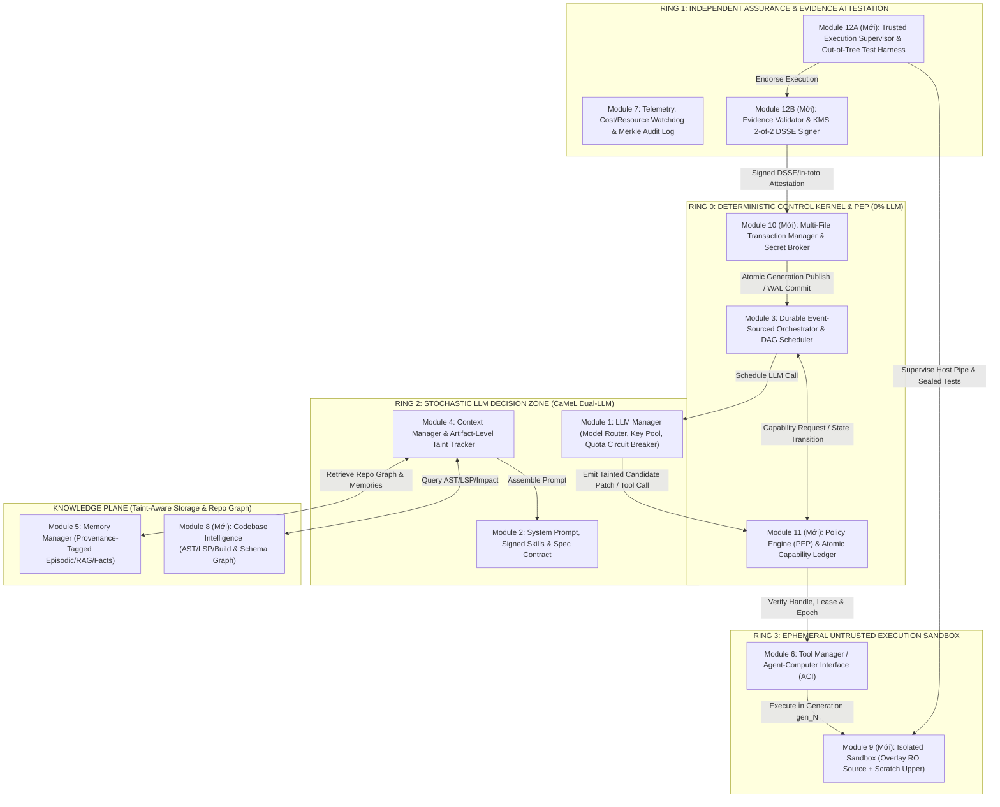

# BIÊN BẢN PHẢN BIỆN 6 VÒNG (ANTIGRAVITY ⟷ CODEX CLI) & KIẾN TRÚC THAM CHIẾU CODING AGENT (12 MODULE / 4-PLANE / 5-RING)

Tài liệu này ghi lại toàn bộ 6 vòng thảo luận và phản biện thực tế giữa **Antigravity (Builder)** và **Codex CLI (Reviewer)** qua `open-agent-bridge`, tuân thủ nghiêm ngặt quy tắc tại [`agent_to_agent_rule.md`](file:///D:/Project%20Prompt/Conversation_rule/agent_to_agent_rule.md) và kết hợp nghiên cứu từ các Coding Agent hàng đầu hiện nay (**SWE-agent, OpenHands, Claude Code, Aider, LangGraph, DeepMind CaMeL**).

---

## PHẦN I: TRẢ LỜI TRỰC DIỆN CÂU HỎI CỐT LÕI CỦA USER

### 1. Mô hình 7 Module ban đầu đã đủ để tạo 1 AI Agent code dự án bất kỳ chưa?
- **Kết luận đồng thuận từ cả 2 Agent:** **CHƯA ĐỦ.**
- **Lý do:** 7 module ban đầu (`1. llm_manager`, `2. prompt_manager`, `3. orchestrator`, `4. context_manager`, `5. memory_manager`, `6. tool_manager`, `7. monitoring & validators`) mới chỉ tạo thành khung của một **General Conversational / Tool-Calling Agent** (trợ lý hỏi đáp và gọi hàm đơn lẻ). Khi áp vào bài toán **Autonomous Software Engineering (code dự án bất kỳ)**, nó thiếu môi trường thực thi cô lập, thiếu khả năng hiểu cấu trúc mã nguồn (AST/LSP/Build Graph), thiếu cơ chế giao dịch nhiều file (Transactional Patch/Rollback), thiếu bộ kiểm thử độc lập (Verification Harness) và lỗ hổng phân quyền rất lớn khi chạy lệnh shell/test.

### 2. Ưu điểm và Nhược điểm của 7 Module gốc

| Khía cạnh | Ưu điểm của 7 Module gốc | Nhược điểm khi dùng để Code dự án thực tế |
| :--- | :--- | :--- |
| **Kiến trúc tổng thể** | Tách biệt trực quan mặt phẳng suy luận (LLM, Prompt, Context), dữ liệu (Memory) và công cụ (Tool, Monitoring). Dễ hiểu, dễ theo dõi. | Thiết kế phẳng (Flat Modules), chưa phân tách **Deterministic Control Kernel** khỏi **Untrusted Stochastic LLM**. |
| **Module 3 (`orchestrator`)** | Đáp ứng tốt vòng lặp ReAct ngắn hạn. | Dễ rơi vào vòng lặp sửa lỗi vô hạn (infinite repair loop), thiếu DAG Task Scheduler, thiếu Event Log bền vững để resume sau khi crash. |
| **Module 4 & 5 (`context` & `memory`)** | Có cắt tỉa token và RAG cơ bản. | RAG vector truyền thống thất bại khi tìm kiếm call-graph/cross-file dependency; dễ bị **Indirect Prompt Injection** từ mã nguồn/README/log độc hại và nhiễm bẩn bộ nhớ (Memory Poisoning). |
| **Module 6 (`tool_manager`)** | Đăng ký và gọi tool qua JSON Schema linh hoạt. | Cho phép chạy lệnh bash/file trực tiếp trên máy thật hoặc phân quyền theo tên lệnh (`pytest`, `make`) cực kỳ nguy hiểm vì `pytest`/`conftest.py`/`setup.py` thực chất là **Arbitrary Code Execution**. |
| **Module 7 (`monitoring & validators`)** | Có kiểm duyệt Input/Tool/Output cơ bản. | Gộp chung Policy Enforcement, Quality Verification và Telemetry; nếu dùng cùng LLM để vừa code vừa chấm bài sẽ chia sẻ chung điểm mù (Shared Blind Spot). |

### 3. Năm (05) Module Mở Rộng Bắt Buộc (Nâng cấp từ 7 lên 12 Module trong 4 Plane & 5 Ring)

Để giữ nguyên 7 module gốc của bạn làm xương sống dễ theo dõi nhưng khắc phục toàn bộ nhược điểm trên, hệ thống được mở rộng thêm **5 module chuyên biệt cho Coding Agent** (tổng cộng **12 Module**):
- **Module 8 (`codebase_intelligence`):** Incremental Repo Map (Tree-sitter AST, LSP, Build/Schema Graph, Dependency Impact Analysis).
- **Module 9 (`workspace_sandbox`):** Môi trường thực thi cô lập (MicroVM / Container / OS Sandbox) với Layered Mount (`Immutable Source Lowerdir` + `Writable Scratch Upperdir`) và quản lý phiên bản theo Generation (`gen_<N>`).
- **Module 10 (`transaction_journal_and_secret_broker`):** Giao dịch áp dụng patch nhiều file (Multi-File Staging/Atomic Publication & Crash-Recoverable Undo/Redo WAL) + Secret Broker tiêm credential qua Egress Proxy không bao giờ lộ raw secret cho LLM.
- **Module 11 (`policy_engine_pep`):** Bộ thực thi chính sách tất định (Deterministic Out-of-LLM Policy Enforcement Point), quản lý Capability Token nguyên tử, Fencing Epoch và kiểm tra đường dẫn qua OS File Handle.
- **Module 12 (`verification_harness_and_attestation`):** Khung kiểm định độc lập nằm ngoài source tree (`Out-of-Tree Trusted Test Runner`), tách biệt hoàn toàn khỏi khóa ký (`DSSE / in-toto 2-of-2 KMS Attestation`).

---

## PHẦN II: BIÊN BẢN TRANH LUẬN & PHẢN BIỆN 6 VÒNG (ANTIGRAVITY ⟷ CODEX CLI)

### Vòng 1 (Round 1)
- **[ROUND 1 - BUILDER (Antigravity)]:**
  - Khẳng định 7 module chưa đủ; đề xuất bổ sung 5 thành phần: (1) Workspace Sandbox & Git Worktree Rollback, (2) Codebase Intelligence (AST/LSP), (3) Plan-Execute-Verify Loop, (4) Sub-Agent Delegation, (5) Phân quyền 3 cấp (`ALLOW`, `ASK_USER`, `DENY`) và Sub-agent `READ_ONLY`.
- **[ROUND 1 - REVIEWER (Codex CLI) — Trạng thái: `[CONTINUE]`]:**
  - **Phản biện 12 lỗ hổng:**
    1. *"Code dự án bất kỳ"* không có biên giới (Capability Envelope) thì không thể kiểm chứng (firmware/kernel khác hẳn web app).
    2. Phân quyền theo tên lệnh (`ALLOW` cho `pytest`/`make`) là **lỗ hổng chí mạng**: test runner và build script thực thi code tùy ý trong repo (`conftest.py`, `Makefile`).
    3. Sub-agent `READ_ONLY` vẫn có thể làm rò rỉ secret qua prompt injection hoặc output.
    4. Thiếu cơ chế chống xung đột khi nhiều Sub-agent sửa chung codebase.
    5. Gộp chung Policy Enforcement và Validator vào Module 7 làm mất tính độc lập.
  - **Đề xuất của Reviewer:** Tổ chức lại thành **4 Plane** (`Control`, `Knowledge`, `Execution`, `Assurance`), dùng **Capability Token ngắn hạn** kiểm tra ngoài LLM và **Transaction Journal** (`Reversible`, `Compensatable`, `Irreversible`).

---

### Vòng 2 (Round 2)
- **[ROUND 2 - BUILDER (Antigravity)]:**
  - Tiếp thu và thiết kế **Capability Envelope 3 Tier** (Tier 1 Full Autonomous, Tier 2 Assisted Remote/Simulator, Tier 3 Human-Gated).
  - Ánh xạ 7 module gốc + 5 module mới vào **4 Plane** kèm **Trust Boundaries (TB0–TB4)**.
  - Đưa ra **Durable State Machine** và **Ma trận Phân quyền theo Principal** (Main Orchestrator, Explorer, Coder chạy `--network=none` trên Git Worktree riêng, Verifier, Integration Agent, Human Operator).
- **[ROUND 2 - REVIEWER (Codex CLI) — Trạng thái: `[CONTINUE]`]:**
  - **Phản biện 15 lỗ hổng sâu hơn:**
    1. **Plane ≠ Trust Boundary:** Đặt `llm_manager` (stochastic, dễ bị injection) chung boundary với `orchestrator` (deterministic kernel) là sai.
    2. **Spotlighting (delimiter) không chặn được Indirect Prompt Injection:** Cần Taint/Provenance tracking.
    3. **`AST-parsed shell command` tạo cảm giác an toàn giả:** Phải dùng OS/Container syscall & binary digest allowlist.
    4. **`git worktree` không phải là ranh giới cô lập:** File `.git` của worktree trỏ về repo chính (hooks, config, objects dùng chung).
    5. **TOCTOU & Confused Deputy:** Kiểm tra đường dẫn bằng chuỗi bị lỗi Time-of-Check to Time-of-Use; Secret Broker có thể bị lừa qua HTTP redirect/SSRF.

---

### Vòng 3 (Round 3)
- **[ROUND 3 - BUILDER (Antigravity)]:**
  - Nâng cấp lên **5 Ring cô lập theo Process/Container/UID**:
    - `Ring 0`: Deterministic Control Kernel & PEP (0% LLM code).
    - `Ring 1`: Assurance & Evidence Store.
    - `Ring 2A (P-LLM)` & `Ring 2B (Q-LLM)`: Áp dụng mô hình **Google DeepMind CaMeL** tách luồng điều khiển khỏi dữ liệu nhiễm bẩn (`TAINTED_REPO`).
    - `Ring 3`: Ephemeral MicroVM/Container Sandbox.
  - Thay `git worktree` bằng CoW Snapshot; thay kiểm tra đường dẫn chuỗi bằng `openat2(RESOLVE_NO_SYMLINKS)`; thêm `fencing_epoch` và Bounded Repair Loop (`max_repair_attempts = 3`).
- **[ROUND 3 - REVIEWER (Codex CLI) — Trạng thái: `[CONTINUE]`]:**
  - **Phản biện 18 điểm mù hệ thống & mật mã:**
    1. **Ring 1 vừa chạy test vừa giữ khóa ký (`Evidence Attestation Key`) là lỗi nghiêm trọng:** Nếu test độc hại thoát sandbox, nó chiếm khóa ký và tự ký pass giả.
    2. **P-LLM hoàn toàn không đọc code thì không lập kế hoạch đúng được**, còn `TRUSTED_USER` nhầm lẫn giữa *Authority* (quyền ra lệnh) và *Data Integrity* (user có thể paste log chứa mã độc).
    3. **Capability Token ký số (Immutable) nhưng lại chứa trường `used_count` khả biến là mâu thuẫn:** Phải tách sang Atomic Consumption Ledger.
    4. **Gộp chung Commit và Release** làm hệ thống quá nặng khiến lập trình viên tìm cách tắt bảo mật.
    5. **Immutable Audit Log xung đột với quyền xóa dữ liệu (Right-to-Delete):** Cần cơ chế Crypto-Erasure.

---

### Vòng 4 (Round 4)
- **[ROUND 4 - BUILDER (Antigravity)]:**
  - Tách Ring 1 thành 3 mắt xích: `Untrusted Runner (Ring 3)` ➔ `Deterministic Evidence Validator (Ring 1A)` ➔ `HSM/KMS Minimal Signer (Ring 1B)`.
  - Thiết lập **Lattice 3 chiều (`Authority × Integrity/Provenance × Confidentiality`)**; cho phép P-LLM đọc code nhưng kế thừa nhãn `TAINTED` (cấm tự mở rộng Capability nếu không qua Step-Up Approval).
  - Đưa `used_count` vào **Atomic Consumption Ledger (CAS)** và bổ sung quy trình **Hard Kill (`SIGKILL` cgroup/VM + đóng socket + xoay vòng key)**.
  - Thiết kế **5 Progressive Gates (`G1 Checkpoint` ➔ `G2 Local Commit` ➔ `G3 Integration Merge` ➔ `G4 Release Candidate` ➔ `G5 Prod Deploy`)** và **3 Operational Profiles (`L1 Local Dev`, `L2 Team CI`, `L3 Enterprise Zero-Trust`)**.
- **[ROUND 4 - REVIEWER (Codex CLI) — Trạng thái: `[CONTINUE]`]:**
  - **Ghi nhận kiến trúc đã tiệm cận chuẩn tham chiếu, nhưng chỉ ra 4 Blocker cần chốt:**
    1. **Authority không phải thứ tự tuyến tính (`HUMAN > RING0`):** Phải là tập quyền trực giao + các Hard Invariants không ai được vượt qua. Taint ở mức từng token LLM không khả thi (gây taint explosion), phải gắn ở mức **Artifact**.
    2. **Evidence Trust Gap tại Ring 1A:** Runner có thể trả log giả mà không thực sự chạy test; phép nối chuỗi `||` khi ký dễ bị lỗi canonicalization (cần chuẩn **DSSE / in-toto v1.0**).
    3. **CAS từng file lẻ không đảm bảo tính nguyên tử cho toàn bộ Patch nhiều file** khi mất điện giữa chừng.
    4. **Profile L1 đang nới lỏng quá mức** (bỏ sót `.git/hooks`, CI workflows, Docker socket) và raw hash trong Crypto-Erasure có thể bị tấn công từ điển.

---

### Vòng 5 (Round 5)
- **[ROUND 5 - BUILDER (Antigravity)]:**
  - Giải quyết 4 Blocker: (1) **Orthogonal Capability Lattice + Hard Invariants + Artifact-Level Declassification**, (2) **Trusted Execution Supervisor (nằm ở Host/Hypervisor ngoài Guest) + DSSE/in-toto v1.0 (RFC 8785 JCS) + 2-of-2 Quorum Signing**, (3) **Multi-File Staging Transaction + Undo/Redo WAL + Cross-Platform Path Hardening (Unicode NFC, Case-fold, NTFS ADS/Reparse Point)**, (4) **Minimum Security Baseline cho cả L1–L3 + Keyed HMAC Commitments + Post-Deploy Canary + Quantitative Benchmark Suite**.
- **[ROUND 5 - REVIEWER (Codex CLI) — Trạng thái: `[CONTINUE]`]:**
  - **Chỉ ra 2 Blocker kỹ thuật cuối cùng trước khi đồng thuận:**
    1. **Trusted-Test Problem:** Supervisor thu exit code 0 từ ngoài VM vẫn chưa đủ nếu chính bộ test trong repo bị sửa để luôn `return 0` (hoặc xóa assertion). Cần **Out-of-Tree Trusted Test Harness & Expected-Test Manifest** độc lập với repo, đồng thời source tree cần **Layered Mount (Read-Only Lower + Writable Scratch Upper)** để trình biên dịch hoạt động được.
    2. **Atomic Visibility vs Crash-Recoverable Apply:** Trên ext4/NTFS thường, sửa tuần tự kèm WAL chỉ là *Crash-Recoverable*, không phải *Atomic Visibility* cho các tiến trình đọc đồng thời. Cần **Generation-Based Workspace Publication (`gen_<N>`)** cho Atomic Visibility và phân lớp **Normative Specification (`Core MUST` / `Profile Extensions` / `Optional`)**.

---

### Vòng 6 (Round 6 — Đạt Đồng Thuận Toàn Diện)
- **[ROUND 6 - BUILDER (Antigravity)]:**
  - Thiết lập **Out-of-Tree Trusted Verification Harness** (`/opt/ring1_trusted_harness` mount Read-Only từ Ring 1, kiểm tra `expected_test_manifest`, bytecode coverage trace và bộ Sealed Acceptance Tests độc lập) + **Overlay Mount (`lowerdir` RO + `upperdir` scratch)**.
  - Phân tách minh bạch **Mode 1: Generation-Based Immutable Tree Publication (`workspaces/gen_<N>` + atomic pointer switch + reader lease = True Atomic Visibility)** và **Mode 2: Crash-Recoverable In-Place Apply (Idempotent Checksummed WAL cho IDE ngoài)**.
  - Đổi tên `BOUNDED_VERIFIED_PATCH` thành `CAPABILITY_BOUNDED_CANDIDATE`, dùng Handle-Based Path Verification (`GetFinalPathNameByHandleW` / `openat2`), chuẩn hóa DSSE PAE + 2-of-2 Endorsement (`Supervisor AND Validator` ➔ `KMS Policy Signer`), `Bounded-Staleness Lease Abort (10s)`, tách Plaintext Structural Merkle Log khỏi Encrypted Blob Store (kèm Deletion SLO), và chia 3 tầng Normative (`Core MUST`, `Profile Extensions`, `Optional`).
- **[ROUND 6 - REVIEWER (Codex CLI) — Trạng thái: `[AGREED] [CONSENSUS_REACHED]`]:**
  - **Phán quyết của Reviewer:** *"Kiến trúc đã đạt mức **Reference Architecture hoàn chỉnh** và đủ điều kiện `[CONSENSUS_REACHED]`. Hai blocker cuối đã được giải quyết đúng hướng... Đây là kiến trúc phù hợp để làm **Normative Reference Specification** cho Coding Agent từ local developer assistant đến enterprise zero-trust."*

---

## PHẦN III: KIẾN TRÚC THAM CHIẾU TỐI ƯU NHẤT (NORMATIVE REFERENCE ARCHITECTURE)




---

# PHẦN II: PHASE 2 DEBATE — TINH GỌN VỀ ĐÚNG 7 MODULE LÕI THEO QUYẾT ĐỊNH CỦA USER (5 ROUNDS ➔ `[CONSENSUS_REACHED]`)

## 1. Quyết định Kiến trúc Tối cao của User (Phase 2 Constraints)
1. **Giữ đúng 7 Module Lõi cho AI Agent (`src/agent_core/`):** Không mở rộng thành 12 module cấp cao.
2. **Mục 1 (`codebase_intelligence` - AST/LSP/Repo Map):** Tách ra làm **Công cụ hỗ trợ bên ngoài (`extensions/external_coding_tools`)** cắm vào `Module 6 (tool_manager)` hoặc `Module 5 (memory_manager)`. Thiếu nó, AI Agent 7 module vẫn hoạt động bình thường.
3. **Mục 2 (`sandbox`), Mục 3 (`transaction & secret`), Mục 4 (`policy_engine_pep`):** Gom toàn bộ vào **Module 7** và đổi tên Module 7 thành **`runtime_governance`**.
4. **Mục 5 (`verification_harness` - Out-of-tree CI/Eval/Attestation):** Đặt làm **Lớp vỏ bọc phụ trợ bên ngoài 7 module (`extensions/outer_verification_harness`)**. Không có lớp vỏ này, AI Agent vẫn làm việc độc lập bình thường.

---

## 2. Biên bản Tranh biện Trực tiếp Phase 2 (Antigravity `[BUILDER]` ⟷ Codex CLI `[REVIEWER]`)

### Vòng 1 (Phase 2 - Round 1)
- **`[PHASE 2 - ROUND 1 - BUILDER]` (Antigravity):**
  - Đề xuất giữ 7 module lõi, đổi tên Module 7 thành `guardrails_and_monitoring` (hoặc `security_governance_and_monitoring`), chia nội bộ Module 7 thành 4 sub-packages (`permission_pep`, `sandbox_isolation`, `transaction_and_secret`, `validators_and_telemetry`) và đưa `external_coding_tools` + `outer_verification_harness` ra `extensions/`.
- **`[PHASE 2 - ROUND 1 - REVIEWER]` (Codex CLI):**
  - **Đề xuất tên chuẩn cho Module 7:** **`runtime_governance`** — bao quát đúng 1 trách nhiệm cấp module (SRP): *"Quản trị mọi tương tác tại runtime đi qua trust boundary hoặc có side-effect"*, với interface chính `GovernedToolExecutor`.
  - **Phát hiện 8 điểm yếu:**
    1. Chia 4 sub-packages vẫn ghép gượng ép (`transaction_and_secret` và `validators_and_telemetry` có lý do thay đổi khác nhau) ➔ Cần tách thành **6 sub-packages có độ kết dính cao (High Cohesion)**: `policy_enforcement`, `isolation`, `transaction`, `secret_broker`, `content_safety`, `audit_observability`.
    2. Nguy cơ Circular Dependency giữa `Module 6 (tool_manager)` và `Module 7 (runtime_governance)` ➔ Giải quyết bằng **Dependency Inversion (Decorator Pattern)** qua contracts trung lập.
    3. `Module 3 (orchestrator)` biết quá nhiều chi tiết pipeline của Module 7.
    4. Filesystem WAL không thể rollback side-effect bên ngoài (gửi email, gọi API, shell) ➔ Cần phân loại side-effect.
    5. TOCTOU trong kiểm tra đường dẫn string.
    6. Không được mở WAL hay giữ lock khi đang chờ `ASK_USER`.
    7. Rò rỉ biến mật nếu đưa vào `ToolCallRequest` rồi mới redact ở đầu ra.
    8. Trùng quyền sở hữu nhãn Taint giữa `Module 4 (context_manager)` và `Module 7`.
  - **Trạng thái:** `[CONTINUE]`

### Vòng 2 (Phase 2 - Round 2)
- **`[PHASE 2 - ROUND 2 - BUILDER]` (Antigravity):**
  - Chốt tên `runtime_governance` với 6 sub-packages nội bộ.
  - Áp dụng Dependency Inversion qua `shared/contracts.py`.
  - Phân loại 4 `SideEffectClass` (`READ_ONLY`, `WORKSPACE_TRANSACTIONAL`, `EXTERNAL_COMPENSATABLE`, `EXTERNAL_IRREVERSIBLE`).
  - Thiết kế `PendingExecutionIntent` cho `ASK_USER` (không giữ lock/WAL khi chờ User) và giao quyền sở hữu duy nhất `TaintLabel` cho `Module 4 (context_manager)`.
- **`[PHASE 2 - ROUND 2 - REVIEWER]` (Codex CLI):**
  - **Phát hiện 8 edge cases sâu hơn:**
    1. Enum đơn `SideEffectClass` không biểu diễn được tool đa hiệu ứng (vừa sửa file, vừa gọi mạng, vừa đọc secret) và AST/LSP không mặc nhiên `READ_ONLY`.
    2. `reserve/commit/release` chưa xử lý được cửa sổ crash sau khi đã phát lệnh ra ngoài nhưng trước khi `commit` (`INDETERMINATE`).
    3. `workspace_digest` toàn cục gây false conflict khi file không liên quan thay đổi và chưa chặn được TOCTOU sát syscall.
    4. `SafeWorkspaceHandle` không áp dụng được cho mọi CLI/LSP bên ngoài tự mở file bằng pathname.
    5. Nguy cơ bypass governance nếu `RawToolExecutor` và `GovernedToolExecutor` dùng chung 1 kiểu `ToolExecutionPort`.
    6. Cần thu hẹp cam kết của `secret_broker` khi subprocess buộc phải đọc secret.
    7. Compensation bên ngoài là Saga (có thể lỗi một phần), không được gọi là atomic rollback.
    8. Một file `shared/contracts.py` duy nhất dễ biến thành coupling hub.
  - **Trạng thái:** `[CONTINUE]`

### Vòng 3 (Phase 2 - Round 3)
- **`[PHASE 2 - ROUND 3 - BUILDER]` (Antigravity):**
  - Tách `shared/` thành 3 bounded contracts (`execution_contracts.py`, `governance_contracts.py`, `audit_contracts.py`) và tách kiểu `RawToolBackendPort` vs `GovernedToolExecutionPort`.
  - Thay enum đơn bằng `EffectProfile` đa chiều + `PlannedEffects`.
  - Bổ sung máy trạng thái `PREPARED → DISPATCHED → CONFIRMED | INDETERMINATE` và ngữ nghĩa Saga (`COMPENSATED`, `PARTIALLY_COMPENSATED`, `COMPENSATION_FAILED`).
  - Thay digest toàn workspace bằng `ResourceVersionCondition` (CAS theo tài nguyên đích) và 3 mức `IsolationAssuranceLevel`.
- **`[PHASE 2 - ROUND 3 - REVIEWER]` (Codex CLI):**
  - **Phát hiện 5 điểm cần khóa chặt:**
    1. `Module 7` không được tin tưởng mù quáng vào `PlannedEffects` do chính tool/plugin (Module 6) tự khai báo ➔ Phải tách `DeclaredEffects` (không đáng tin) và `AuthorizedExecutionPlan` (do Module 7 lập dựa trên `OperatorApprovedToolManifestRegistry`).
    2. Mâu thuẫn quyền sở hữu Subprocess: Nếu `Module 6` trực tiếp chạy subprocess thì `Module 6` tất yếu thấy raw stdout/stderr và secret trước DLP ➔ Chốt phương án bảo mật mạnh: `Module 7` sở hữu Process Launcher, Sandbox, Secret Injection và Raw Streams; `Module 6` chỉ tạo `ToolInvocationPlan` và parse output đã scrub.
    3. `READ_ONLY` qua mạng không đồng nghĩa với `SAFE_RETRY` ➔ Cần trường `RetrySemantics` độc lập.
    4. Làm rõ giới hạn của Generation Lease trước các tiến trình ngoài sandbox (IDE/antivirus).
    5. Diễn đạt Type-Level Separation đúng bản chất là guardrail chống nối dây nhầm (accidental miswiring).
  - **Trạng thái:** `[CONTINUE]`

### Vòng 4 (Phase 2 - Round 4)
- **`[PHASE 2 - ROUND 4 - BUILDER]` (Antigravity):**
  - Tách `DeclaredEffects` và `AuthorizedExecutionPlan` dựa trên `OperatorApprovedToolManifestRegistry` thuộc `Module 7`.
  - Chuyển `Module 6 (tool_manager)` thành `ToolPlanAndCodecPort` (chỉ sinh `ToolInvocationPlan` và parse `ScrubbedExecutionOutput`); `Module 7` nắm giữ hoàn toàn Process Launcher, Sandbox, Secret Injection và DLP Scrubber.
  - Bổ sung `RetrySemantics` (`SAFE_RETRY`, `RETRY_WITH_IDEMPOTENCY_KEY`, `QUERY_STATUS_BEFORE_RETRY`, `NEVER_AUTO_RETRY`) và 3 mức `IsolationAssuranceLevel` (`HANDLE_ENFORCED`, `SNAPSHOT_AND_OVERLAY_ENFORCED`, `COOPERATIVE_WORKSPACE_LEASE`).
- **`[PHASE 2 - ROUND 4 - REVIEWER]` (Codex CLI):**
  - **Phát hiện điểm chặn cuối cùng:**
    1. `InProcessCallableSpec(handler_fn, ...)` chứa tham chiếu hàm Python (`handler_fn`) — đây là executable capability chứ không phải Pure Data DTO, cho phép plugin tuồn code chạy trực tiếp trong tiến trình đặc quyền của `Module 7`.
    2. Cần thay bằng Pure Data ID (`PureFunctionSpec(trusted_function_id, serialized_args)`) chỉ trỏ vào `TrustedInProcessPureRegistry` do `Module 7` sở hữu (chỉ dành cho hàm thuần không I/O trong TCB), và dùng `AuthorizedResourceSet` tối thiểu.
    3. Bổ sung ràng buộc ngữ nghĩa (`allowed_executable_digests`, `argv_schema_constraints`, `http_route_constraints`) + `DimensionEnforcementMode` vào `OperatorApprovedToolManifestRegistry`.
  - **Trạng thái:** `[CONTINUE]`

### Vòng 5 (Phase 2 - Round 5)
- **`[PHASE 2 - ROUND 5 - BUILDER]` (Antigravity):**
  - Loại bỏ hoàn toàn `handler_fn` khỏi `ToolInvocationPlan`. Mọi kế hoạch thực thi từ `Module 6` là 100% Pure Serializable Data (`WorkspaceFileOpSpec`, `SubprocessSpec`, `HttpEgressSpec`, `PureFunctionSpec` dùng `JsonValue` đóng).
  - Khóa `TrustedInProcessPureRegistry` và `AuthorizedResourceSet` bên trong `Module 7 (runtime_governance)`.
  - Bổ sung `DimensionEnforcementMode` (`ENFORCED_BY_RUNTIME_BOUNDARY`, `VERIFIED_BY_STATIC_CONSTRAINT`, `UNVERIFIABLE_SEMANTIC_EFFECT` ➔ tự động nâng lên `DENY`/`ASK_USER` + `NEVER_AUTO_RETRY`).
- **`[PHASE 2 - ROUND 5 - REVIEWER]` (Codex CLI):**
  - Xác nhận: `"[AGREED] Điểm chặn cuối đã được giải quyết: execution plan chỉ còn dữ liệu tuần tự hóa, plugin không thể đưa callable vào TCB, và semantic effects được cưỡng chế độc lập với khai báo của plugin... Trạng thái lượt: [CONSENSUS_REACHED]"`.

---

## 3. Sơ đồ Kiến trúc 7 Module Lõi + 2 Thành phần Phụ trợ (Bản Chốt Consensus Phase 2)

```
=====================================================================================
[PHỤ TRỢ B - NGOÀI LÕI] extensions/outer_verification_harness (Optional CI/Eval)
  (Chỉ gọi Public API của Orchestrator & kiểm định ExecutionReceipt / AuditEvent)
=====================================================================================
                                         │
                                         ▼
┏━━━━━━━━━━━━━━━━━━━━━━━━━━━━━━━━━━━━━━━━━━━━━━━━━━━━━━━━━━━━━━━━━━━━━━━━━━━━━━━━━━━┓
┃                        LÕI AI AGENT: ĐÚNG 7 MODULE CHÍNH                          ┃
┃                              (src/agent_core/)                                    ┃
┃                                                                                   ┃
┃  ┌──────────────────────┐   ┌──────────────────────┐   ┌───────────────────────┐  ┃
┃  │ 1. llm_manager       │   │ 2. prompt_manager    │   │ 5. memory_manager     │  ┃
┃  │ - Model Registry     │   │ - App/User/Session   │   │ - Working History     │  ┃
┃  │ - API Key Pool       │   │ - Dynamic Skills     │   │ - Episodic / Semantic │  ┃
┃  │ - Token Budget       │   └──────────┬───────────┘   │ - Entity Fact Store   │  ┃
┃  │ - Fallback Chain     │              │               └───────────┬───────────┘  ┃
┃  └──────────▲───────────┘              ▼                           ▼              ┃
┃             │               ┌──────────────────────────────────────────────────┐  ┃
┃             │               │ 4. context_manager (Single Owner of TaintLabel)  │  ┃
┃             │               │ - Provenance Tagging & Sliding Window Compaction │  ┃
┃             │               └──────────────────────────▲───────────────────────┘  ┃
┃             │                                          │                          ┃
┃  ┌──────────┴──────────────────────────────────────────┴───────────────────────┐  ┃
┃  │ 3. orchestrator                                                             │  ┃
┃  │ - Durable Session State Machine                                             │  ┃
┃  │ - Chỉ phụ thuộc: GovernedToolExecutionPort & ConversationGovernancePort     │  ┃
┃  └─────────────────────────────────────┬───────────────────────────────────────┘  ┃
┃                                        │                                          ┃
┃                                        ▼                                          ┃
┃  ┌─────────────────────────────────────────────────────────────────────────────┐  ┃
┃  │ 7. runtime_governance (GovernedToolExecutor & ConversationGovernancePort)   │  ┃
┃  │   ├── 7.1 policy_enforcement (OperatorManifestRegistry, PEP, AttemptLedger) │  ┃
┃  │   ├── 7.2 isolation          (AuthorizedResourceSet, Sandbox/ProcessRunner) │  ┃
┃  │   ├── 7.3 transaction        (Resource CAS Lease, Workspace WAL, Ext Saga)  │  ┃
┃  │   ├── 7.4 secret_broker      (secret_ref:// Egress Proxy / Ephemeral FD)    │  ┃
┃  │   ├── 7.5 content_safety     (Input Guardrails & Raw Stream DLP Scrubber)   │  ┃
┃  │   └── 7.6 audit_observability(Signed ExecutionReceipt, Telemetry, Quotas)   │  ┃
┃  └─────────────────────────────────────┬───────────────────────────────────────┘  ┃
┃                                        │ gọi ToolPlanAndCodecPort (Pure Data)     ┃
┃                                        ▼                                          ┃
┃  ┌─────────────────────────────────────────────────────────────────────────────┐  ┃
┃  │ 6. tool_manager (ToolPlanAndCodecPort)                                      │  ┃
┃  │ - Tool Registry, JSON Schema, Pydantic Arg Validation                       │  ┃
┃  │ - prepare_invocation() -> Pure Data ToolInvocationPlan                      │  ┃
┃  │   (WorkspaceFileOpSpec | SubprocessSpec | HttpEgressSpec | PureFunctionSpec)│  ┃
┃  │ - parse_output(ScrubbedExecutionOutput) -> ToolResult                       │  ┃
┃  └─────────────────────────────────────▲───────────────────────────────────────┘  ┃
┗━━━━━━━━━━━━━━━━━━━━━━━━━━━━━━━━━━━━━━━━┿━━━━━━━━━━━━━━━━━━━━━━━━━━━━━━━━━━━━━━━━━━┛
                                         │ (Cắm thêm khi cần, không có vẫn chạy)
=========================================┼===========================================
[PHỤ TRỢ A - NGOÀI LÕI] extensions/external_coding_tools (AST / LSP / Repo Graph MCP)
=====================================================================================
```


---

# PHẦN III: PHASE 3 DEBATE — KHÓA CHẶT CÁC NHƯỢC ĐIỂM, RỦI RO CỐT LÕI (`RISK-01..08`) & RỦI RO THỨ CẤP (`SEC-RISK-01..06`) (4 ROUNDS ➔ `[CONSENSUS_REACHED]`)

Toàn bộ phân tích chi tiết đã được chuẩn hóa và lưu tại [ARCHITECTURE_RISK_AND_TRADEOFF_REPORT.md](file:///d:/AI%20Agent%20Architecture/ARCHITECTURE_RISK_AND_TRADEOFF_REPORT.md):
- **Round 1/5 (`87b52c4`):** Đề xuất 6 cơ chế giảm thiểu cho `RISK-01..08` và phát hiện 6 rủi ro thứ cấp (`SEC-RISK-01..06`) cùng Bảng điều kiện hạ cấp (`Downgrade / Fallback Matrix`).
- **Round 2/5 (`684f1a6`):** Khóa chặt `SHADOW_STAGING` độc lập với `AuthorizedWriteSet` & `InputManifest`, `StatusProbeSpec` 4 trạng thái + Single-Writer Saga Lease, Streaming DLP mặc định hủy raw output, phân loại Preset `REPO_CODE_EXECUTION` cho `pytest`, bảo toàn `ProvenanceLineage` và Handle-walk đa nền tảng (`openat2` / `FILE_FLAG_OPEN_REPARSE_POINT` + `FileId`).
- **Round 3/5 (`4693da8`):** Tinh chỉnh 4 chi tiết kỹ thuật cuối: `empty_gitconfig_file` cho `GIT_CONFIG_GLOBAL`/`SYSTEM`, ngữ nghĩa `fencing_token` (local single-owner vs external duplicate residual risk), `Discard + Best-Effort Zeroization`, và bộ 7 thành phần `Full-Context Scoped Approval Binding`.
- **Round 4/5 (`[CONSENSUS_REACHED]`):** Codex CLI kiểm tra trực tiếp Git Commit `4693da8` và xác nhận đạt đồng thuận tuyệt đối (`[AGREED] ... [CONSENSUS_REACHED]`).


---

# PHẦN IV: PHASE 4 DEBATE — HOÀN THIỆN KIẾN TRÚC 6 MODULE CÒN LẠI (M1–M6) VÀ HỢP ĐỒNG XUYÊN MODULE (4 ROUNDS ➔ `[CONSENSUS_REACHED]`)

Sau khi `Module 7 (runtime_governance)` được đặc tả chặt chẽ ở Phase 2 và Phase 3, Phase 4 tập trung giải quyết toàn diện các hợp đồng, ranh giới và máy trạng thái của **6 Module còn lại (M1–M6)**.

## 1. Biên bản Tranh biện Phase 4 (Antigravity `[BUILDER]` ⟷ Codex CLI `[REVIEWER]`)

### Vòng 1 (Phase 4 - Round 1)
- **`[BUILDER]`:** Tự phát hiện và đề xuất giải quyết 6 lỗ hổng kiến trúc lớn của M1–M6:
  - *G1 (Ranh giới M2/M4/M5):* M2 chỉ giữ instruction template có version; M5 lưu/truy xuất memory; M4 là chủ sở hữu duy nhất của `ContextWindow` với token allocation theo section.
  - *G2 (Vòng điều khiển M3):* Event-sourced durable state machine với append-only `SessionControlLog`; ngân sách cứng phiên; loop detection.
  - *G3 (M1 fallback & replay):* `LLMProviderPort` chuẩn hóa; fallback chỉ giữa các model cùng `capability_profile`; phân loại retry.
  - *G4 (M5 write gate):* Phân 4 tầng nhớ (working, episodic, semantic, procedural); chặn tainted data ghi vào semantic/procedural nếu chưa xác minh.
  - *G5 (M6 tool retrieval):* `ToolCatalog` có version; chọn tool theo ngữ cảnh và budget; kết quả lớn lưu artifact.
  - *G6 (Hợp đồng shared):* Error envelope chung; telemetry trung lập; human channel qua M3.
- **`[REVIEWER]` (Codex CLI):** Phản biện 9 điểm: Tách `SessionControlLog` (M3) khỏi `AuditLog` (M7); state machine cần sub-state bất định; 3 lớp ngân sách độc lập (M3 tổng - M4 lần gọi - M1 giới hạn model); phân biệt tuyệt đối instruction vs data; mở rộng `capability_profile`; quy trình ghi memory 2 pha; chọn tool chỉ là discovery; telemetry vs audit tách riêng; đổi `VERIFYING` thành `SELF_REVIEWING` (heuristic).
- **Trạng thái:** `[CONTINUE]`

### Vòng 2 (Phase 4 - Round 2)
- **`[BUILDER]`:** Tiếp thu trọn vẹn 9 điểm, bổ sung 4 lỗ hổng mới: xử lý `ToolBatch` song song, ủy quyền sub-agent (không tạo module 8), tiến hóa schema event log bằng upcaster, và vị trí của Canonical Intermediate Representation (CIR).
- **`[REVIEWER]` (Codex CLI):** Phản biện 7 điểm chuyên sâu: Resume không được suy diễn `INDETERMINATE` chỉ từ việc thiếu receipt; `ToolBatch` cần DAG và failure policy; `delegate_task` là M3-native control primitive nhưng capability phải do M7 cấp; không được pin policy suốt phiên; upcaster phải fail-closed; CIR cần phân tách Authority × Integrity × Confidentiality; crypto-erasure phải giữ được envelope để fold state.
- **Trạng thái:** `[CONTINUE]`

### Vòng 3 (Phase 4 - Round 3)
- **`[BUILDER]`:** Chuẩn hóa: 4 trạng thái reconciliation khi resume; DAG cho `ToolBatch` dựa trên `AuthorizedResourceSet`; `delegate_task` là M3-native primitive với token phái sinh; dynamic policy re-check (`evaluation_policy_version` vs `current_enforcement_policy_version`); upcaster pure & fail-closed; CIR 3 chiều; crypto-erasure payload blob.
- **`[REVIEWER]` (Codex CLI):** Khóa 5 điểm biên cuối cùng: 4 trạng thái reconciliation phải bao phủ cả terminal failure (`TERMINAL_WITH_RECEIPT`); delegation grant do M7 cấp, token do M7 xác minh tại mọi dispatch; lineage không thể suy đoán nhân quả mà phải tách 3 tập (`exposure_set`, `context_influence_set`, `claimed_citations`); input user phân loại theo typed segments (`UserDirectiveSegment`, `QuotedTextSegment`, ...) và fallback `MIXED_USER_CONTENT`; crypto-erasure phải đưa phiên vào `HALTED_CONTENT_ERASED` nếu thiếu dữ liệu để tiếp tục.
- **Trạng thái:** `[CONTINUE]`

### Vòng 4 (Phase 4 - Round 4 — ĐẠT ĐỒNG THUẬN HOÀN TOÀN)
- **`[BUILDER]`:** Chốt chính xác 100% cả 5 điểm biên:
  1. 4 trạng thái reconciliation: `AUTHORITATIVELY_NOT_DISPATCHED`, `TERMINAL_WITH_RECEIPT` (tách `dispatch_state` và `outcome_state`), `QUERY_PENDING`, `UNKNOWN_AMBIGUOUS`.
  2. Delegation: M7 cấp `AuthorizedDelegationGrant`, composition root khởi tạo child session, token do M7 kiểm tra tại mọi dispatch.
  3. Phân định rõ 3 tập lineage: `exposure_set` (audit), `context_influence_set` (taint propagation), `claimed_citations` (UI giải thích).
  4. Typed segments cho user input, fallback an toàn `MIXED_USER_CONTENT` (kế thừa taint).
  5. Envelope chuẩn, CAS append linearizable, randomized blob ID + keyed commitment, trạng thái `HALTED_CONTENT_ERASED` khi blob bị xóa.
- **`[REVIEWER]` (Codex CLI):**
  > `[AGREED] Năm blocker cuối đã được giải quyết đúng ranh giới trách nhiệm M3/M4/M7 và không làm phát sinh module lõi thứ tám... Kiến trúc hiện đã hoàn thiện hợp đồng cho M1–M6, giữ đúng 7 module lõi, đồng thời bảo toàn các bất biến Phase 2–3.`
  > **Trạng thái lượt:** **`[CONSENSUS_REACHED]`**

---

## 2. Đặc tả Chi tiết Hợp đồng Toàn diện 7 Module Lõi (Consensus v4.0-complete)

### 2.1. Module 1: `llm_manager` (Execution & Adapter Layer)
- **Trách nhiệm:** Quản lý Model Registry, Key Pool (hạn mức, xoay vòng, cooldown, rate-limit), `EffectiveModelLimits` và Provider Adapters.
- **`LLMProviderPort`:** Chuẩn hóa CIR thành provider-specific request. Trả về cấu trúc thống nhất: message deltas, tool-call intent, usage/cost, `finish_reason`.
- **Nguyên tắc Fallback:** Chỉ fallback giữa các model cùng `capability_profile` (tool-calling version, JSON schema support, context length, streaming semantics). Chỉ fallback **trước** khi có token hiển thị ra ngoài hoặc phát lệnh tool; sau đó nếu lỗi phải trả `NeedsReplan` về cho M3.
- **Reproducible Reconstruction:** Mỗi lời gọi sinh `ModelInvocationRecord` gắn với content-addressed input blob, adapter version, tool catalog digest, policy version và model snapshot.

### 2.2. Module 2: `prompt_manager` (Instruction Artifact Repository)
- **Trách nhiệm:** Quản lý các Instruction Templates có phiên bản (`SystemPrompt`, `AppRolePrompt`, `SkillTemplates`).
- **Ranh giới:** Không truy xuất dữ liệu, không biết token budget, không chứa lịch sử hội thoại (lịch sử thuộc M3/M4).
- **Phân cấp Chỉ dẫn:** Hỗ trợ quy tắc ưu tiên và phát hiện xung đột: `system_invariant > app_role > user_directive > session_skill`.

### 2.3. Module 3: `orchestrator` (Durable Control Plane)
- **Trách nhiệm:** Vòng điều khiển suy luận – hành động, quản lý phiên làm việc (`AgentSession`), ngân sách tổng (`SessionBudgetLedger`) và điều phối sub-agent.
- **`SessionControlLog`:** Append-only log với CAS append trên `expected_seq` (bảo đảm linearizable write). State của phiên là kết quả fold(events).
- **Composite State Machine:**
  - Top-level: `IDLE → PLANNING → ACTING → OBSERVING → SELF_REVIEWING → FINALIZING → DONE | FAILED | HALTED`.
  - Trong `ACTING`: M3 theo dõi `ToolInvocationSubstate` do M7 công bố (`PREPARED → AWAITING_APPROVAL → AUTHORIZED → DISPATCHED → TERMINAL`).
- **Quản lý Sub-agent (Delegation):** Coi sub-agent là M3-native control primitive (không qua M7 như executable tool). M3 gửi `DelegationRequest` → M7 cấp `AuthorizedDelegationGrant` → Composition root tạo child session với budget escrow từ cha. Con cần vượt quyền thì chuyển `CHILD_AWAITING_PARENT_APPROVAL`.
- **Khôi phục sự cố (Reconciliation):** Khi resume mà intent chưa có observation, M3 đối soát với M7 theo 4 trạng thái (`AUTHORITATIVELY_NOT_DISPATCHED`, `TERMINAL_WITH_RECEIPT`, `QUERY_PENDING`, `UNKNOWN_AMBIGUOUS`).

### 2.4. Module 4: `context_manager` (Context Assembly & Token Budgeting)
- **Trách nhiệm:** Lắp ráp `ContextWindow`, phân bổ token theo `ContextManifest` phụ thuộc, nén cửa sổ trượt (Sliding Window Compaction) và là **Single Source of Truth** về Taint & Provenance.
- **Canonical Intermediate Representation (CIR):** Biểu diễn trung gian đa chiều có 2 kênh logic: `instruction_channel` và `data_channel`. Gắn nhãn 3 chiều độc lập: Authority × Integrity × Confidentiality cho từng segment.
- **Taint Propagation:** Dựa trên `context_influence_set` (toàn bộ dữ liệu thực tế đã đưa vào context để sinh đầu ra), không suy diễn nhân quả cảm tính.
- **Bảo toàn Invariant:** `Pinned Invariants` (quyết định của user, chính sách hệ thống) có quota cứng, không bao giờ bị nén. Nếu quota bắt buộc vượt giới hạn mô hình, trả về `ContextUnsatisfiable` để xin ý kiến User, không cắt tỉa âm thầm.

### 2.5. Module 5: `memory_manager` (Long-Term Knowledge & Fact Store)
- **Trách nhiệm:** Quản lý lưu trữ và truy xuất 4 tầng nhớ: `working` (phiên), `episodic` (lịch sử sự kiện), `semantic` (tri thức tra cứu), `procedural` (quy trình mẫu).
- **Two-Phase Write Gate:** Ghi vào dài hạn phải qua: `MemoryCandidate → Validation/Conflict-Check → Verification/Approval → CommittedMemoryRecord`. Dữ liệu có nhãn Taint không được tự ý ghi vào `semantic/procedural` nếu chưa qua Trusted Verifier hoặc User duyệt.
- **Truy xuất Đa chiều:** `MemoryQuery` hỗ trợ: tenant scope, time range, taint ceiling, record types, token budget và snapshot version.
- **Crypto-Erasure (`forget`):** Tiêu hủy khóa mã hóa (DEK) của payload blob và ghi nhận tombstone; structural metadata được giữ lại phục vụ tính toàn vẹn của audit.

### 2.6. Module 6: `tool_manager` (Tool Catalog & Codec Port)
- **Trách nhiệm:** Quản lý danh mục công cụ (`ToolCatalog`), thẩm định tham số đầu vào (`Pydantic`), chọn lọc công cụ theo ngữ cảnh (`select_tools` - discovery layer), chuyển đổi yêu cầu thành Pure Data `ToolInvocationPlan` và giải mã `ScrubbedExecutionOutput`.
- **Ranh giới Tuyệt đối:** Không sở hữu Process Launcher, không giữ OS file handle, không mở socket mạng, không nắm giữ Secret. Mọi kế hoạch đều là Pure Data Union (`WorkspaceFileOpSpec`, `SubprocessSpec`, `HttpEgressSpec`, `PureFunctionSpec`).

### 2.7. Module 7: `runtime_governance` (Execution Interceptor & TCB)
- **Trách nhiệm:** Cổng thực thi có quản trị duy nhất (`GovernedToolExecutor` & `ConversationGovernancePort`), nắm toàn bộ Trusted Computing Base (TCB) của hệ thống.
- **6 Sub-packages Độc lập (Tuân thủ DAG một chiều):**
  1. `policy_enforcement/`: Đối chiếu `OperatorApprovedToolManifestRegistry`, kiểm tra dynamic policy (`current_enforcement_policy_version`), cấp `AuthorizedDelegationGrant`, quản lý `AttemptLedger`.
  2. `isolation/`: Nắm giữ `AuthorizedResourceSet` (handle-walk chống symlink race trên POSIX/Windows), chạy tiến trình trong `SHADOW_STAGING` hermetic hoặc OS Container.
  3. `transaction/`: Quản lý CAS Resource Lease, `WorkspaceSnapshotWAL` all-or-nothing merge, và Single-Writer Saga Queue có `fencing_token`.
  4. `secret_broker/`: Bơm credential tại Egress Proxy (`EGRESS_PROXY_INJECTED`) hoặc Ephemeral FD; không để raw secret lọt vào M6/M3.
  5. `content_safety/`: Bounded Streaming DLP với cơ chế `Discard + Best-Effort Zeroization` khi phát hiện secret; kiểm duyệt Input Guardrails.
  6. `audit_observability/`: Ký số và xuất bản `ExecutionReceipt` (phân tách `dispatch_state` và `outcome_state`), bảo quản Audit Trail, giám sát Resource Quota.

---

## 3. Sơ đồ Luồng Điều khiển và Dữ liệu Hợp nhất (Unified 7-Module Architecture)

```
=============================================================================================
[EXTENSIONS] outer_verification_harness (CI/Eval)  |  external_coding_tools (AST/LSP MCP)
=============================================================================================
                                         │
                                         ▼
┏━━━━━━━━━━━━━━━━━━━━━━━━━━━━━━━━━━━━━━━━━━━━━━━━━━━━━━━━━━━━━━━━━━━━━━━━━━━━━━━━━━━━━━━━━━━┓
┃                              LÕI AI AGENT: ĐÚNG 7 MODULE                                  ┃
┃                                                                                           ┃
┃   [M2: prompt_manager]            [M5: memory_manager]                                    ┃
┃   - Versioned Instruction Repo    - 4-Tier Memory (Working/Episodic/Semantic/Procedural)  ┃
┃   - Template & Precedence Rules   - Two-Phase Write Gate & Crypto-Erasure                 ┃
┃            │                               │                                              ┃
┃            └───────────────┬───────────────┘                                              ┃
┃                            ▼                                                              ┃
┃               [M4: context_manager] (Single Source of Truth for Taint)                    ┃
┃               - ContextManifest Token Allocation (Strict Priority Quotas)                 ┃
┃               - Assembles Canonical Intermediate Representation (CIR: 3-D Lattice)        ┃
┃               - Calculates context_influence_set for Provenance Lineage                   ┃
┃                            │                                                              ┃
┃                            ▼                                                              ┃
┃   [M1: llm_manager] ◄──────────────► [M3: orchestrator] (Durable Control Plane)          ┃
┃   - LLMProviderPort (CIR-aware)      - Event-Sourced SessionControlLog (CAS Append)       ┃
┃   - Same-Profile Fallback Guard      - State Machine (with M7 ToolInvocationSubstate)     ┃
┃   - Model Limits & Usage Metric      - Native Sub-agent Delegation Controller             ┃
┃                                      - UserInteractionPort Mediator                       ┃
┃                                                    │                                      ┃
┃                                                    ▼                                      ┃
┃                          [M7: runtime_governance] (Sole Execution TCB)                    ┃
┃                          ├── 7.1 policy_enforcement (Dynamic Policy Check & Grants)       ┃
┃                          ├── 7.2 isolation (AuthorizedResourceSet, SHADOW_STAGING)        ┃
┃                          ├── 7.3 transaction (Resource CAS Lease, WAL, Saga DAG)          ┃
┃                          ├── 7.4 secret_broker (Egress Proxy / Ephemeral FDs)             ┃
┃                          ├── 7.5 content_safety (Streaming DLP Discard/Zeroize)           ┃
┃                          └── 7.6 audit_observability (Signed Terminal Receipts)           ┃
┃                                                    │                                      ┃
┃                                                    ▼ (calls ToolPlanAndCodecPort)         ┃
┃                          [M6: tool_manager] (Pure Data Catalog & Codec)                   ┃
┃                          - ToolCatalog & select_tools() Discovery                         ┃
┃                          - prepare_invocation() -> Pure Data ToolInvocationPlan           ┃
┃                          - parse_output(ScrubbedExecutionOutput) -> ToolResult            ┃
┗━━━━━━━━━━━━━━━━━━━━━━━━━━━━━━━━━━━━━━━━━━━━━━━━━━━━━━━━━━━━━━━━━━━━━━━━━━━━━━━━━━━━━━━━━━━┛
```


---

## 4. Kiến trúc Vận hành Thực tế (Production Operational Architecture - Phase 5)

Dưới đây là đặc tả chi tiết 4 bài toán vận hành phức tạp khi triển khai 7 module lõi trên hệ thống production thực tế, đã được hoàn thiện và đồng thuận qua tranh biện đa góc nhìn:

### 4.1 Cạnh tranh Tài nguyên Đa Agent/Đa Phiên trên Shared Workspace
1. **Hai Publication Mode Tách Bạch Tuyệt Đối:**
   - **`GENERATION_PUBLICATION` (True Atomic Visibility):**
     - Áp dụng cho các runtime/build tooling hỗ trợ pointer-aware generation protocol.
     - Dữ liệu được ghi vào thư mục bất biến `gen_<N>`.
     - Quy trình bảo đảm độ bền vững (Durability Protocol):
       - *POSIX:* (1) `fsync` toàn bộ file trong generation; (2) `fsync` các thư mục con từ dưới lên (bottom-up); (3) `fsync` thư mục cha `gen_<N>`; (4) Tạo pointer tạm `current.new` và `fsync`; (5) Atomic rename thay thế `current` (hoặc `RENAME_EXCHANGE` có cơ chế dọn dẹp orphan); (6) `fsync` thư mục cha chứa pointer.
       - *Windows & Network Filesystem:* OS adapter công bố `FilesystemDurabilityMatrix` cho `FlushFileBuffers` và atomic metadata/rename. Nếu không đáp ứng, hệ thống tự động hạ cấp durability contract và cảnh báo operator.
     - Reader bắt buộc phải pin `(generation_id, root_handle)` một lần duy nhất cho toàn bộ read transaction để duy trì transaction isolation.
   - **`IN_PLACE_WAL_APPLY` (Crash-Recoverable cho Môi trường IDE / Filesystem Thông thường):**
     - Mặc định cho các workspace thông thường của lập trình viên.
     - Giữ `WorkspaceGenerationLease` để phân xử thứ tự ghi giữa các Agent writer tuân thủ protocol (không đại diện hay cấm đoán được thao tác trực tiếp của User).
     - Thực hiện CAS từng file ngay trước khi ghi, ghi kèm durable undo/redo WAL có `fencing_token`.
     - Cam kết crash-recoverable, **không cam kết atomic visibility** đối với quan sát viên bên ngoài.
     - **Bảo tồn Dữ liệu Người dùng khi Recovery:** WAL undo chỉ được phép hoàn nguyên khi trạng thái hiện thời của file khớp chính xác với `expected_postimage` bao phủ toàn bộ footprint: `(object_identity, existence_state, content_digest, metadata_fingerprint, ACL_descriptor, xattr_hash, alternate_data_streams)`.
     - Nếu User đã sửa file làm lệch footprint: Tuyệt đối KHÔNG ghi đè dữ liệu của User; giữ nguyên file hiện trạng, trích xuất thay đổi của Agent thành `ConflictArtifact` bền vững (`fsync`) và chuyển phiên sang `MERGE_CONFLICT_SUSPENDED`. Nếu không thể ghi durable `ConflictArtifact`, hệ thống giữ cờ `RECOVERY_REQUIRED` và chặn Agent writer mới.

2. **Namespace Identity & Khóa Phân tầng Tránh Lock Explosion:**
   - **Volume-Specific Comparison Semantics:** Loại bỏ hàm chuỗi chung như `Path.lower()`. Namespace key bắt buộc dựa trên handle đã xác thực `(workspace_root_identity, VolumeSerialNumber, FileId, workspace_generation)` và cơ chế so sánh đặc thù của volume/filesystem (NTFS Case-Preserving Case-Insensitive qua kernel uppercase table; Linux case-sensitive hoặc directory-level casefold).
   - **Hierarchical Intention Locking:** Thay vì snapshot toàn bộ subtree handles gây nổ tài nguyên, hệ thống dùng Intent Lock phân tầng (`IS` - Intent Shared, `IX` - Intent Exclusive) trên các node tổ tiên kết hợp **Handle-Relative Traversal** (`openat` / `NtOpenFile`) và kiểm tra revalidation tính toàn vẹn của handle ngay trước khi mutation.
   - **Ranh giới Threat Model:** Handle identity phát hiện và chặn TOCTOU giữa các client tuân thủ protocol trong threat model đã định nghĩa; không ngăn chặn hành vi thay đổi cấu trúc đĩa của các external actor ngoài protocol.

3. **Mô hình Hợp nhất Phân tầng (Tiered Merge Model):**
   - **Tầng 1 (Auto-Apply):** Áp dụng tự động khi tập file thay đổi trong staging hoàn toàn không giao nhau với các thay đổi trên workspace chính tính từ `base_workspace_generation`.
   - **Tầng 2 (Merge Proposal):** Khi có thay đổi khác dòng trên cùng file, công cụ semantic merge chỉ sinh ra `MergeProposal` có cấu trúc (chứa diff, AST impact report và test validation evidence) để trình User, tuyệt đối không tự ý commit vào workspace chính.
   - **Tầng 3 (Mandatory Approval):** Khi thay đổi đụng vào cùng symbol/API contract, rename/delete, file generated hoặc file manifest phụ thuộc (`pyproject.toml`, lockfiles) ➔ Bắt buộc chuyển sang `ASK_USER` kèm `MergeProposal`.
   - `ExecutionReceipt` lưu trữ đầy đủ `(base_digest, ours_digest, theirs_digest, result_digest, merger_version, validation_evidence)` và công bố minh bạch residual risk ngữ nghĩa.

---

### 4.2 Giao thức Can thiệp Thời gian thực & Ngắt Tiến trình An toàn
1. **Máy trạng thái Can thiệp Hợp tác (Cooperative Preemption State Machine):**
   - Vòng đời: `REQUESTED → ACKNOWLEDGED → QUIESCING → QUIESCED | CANNOT_CANCEL | OUTCOME_UNKNOWN`.
   - **`INTERRUPT_GRACEFUL`:** Đặt `graceful_timeout_ms`. Nếu quá hạn mà tool chưa kết thúc ➔ phát sự kiện `GRACEFUL_TIMEOUT_ESCALATING` để hỏi User có nâng cấp lên ngắt cưỡng bức hay không.
   - **`INTERRUPT_ABORT_ACTION`:** Định danh chính xác là **Best-Effort Cancellation**, không cam kết rollback external side-effect.
     - *Trước `DISPATCHED`:* Hủy bỏ sạch, giải phóng quota/lease và trở về trạng thái an toàn.
     - *Sau `DISPATCHED`:* Gửi tín hiệu kill tiến trình ở M7 `isolation`, sau đó M7 gọi `StatusProbeSpec` (với idempotency key). Nếu probe xác nhận thành công ➔ ghi nhận `TERMINAL_WITH_RECEIPT(SUCCEEDED)`; nếu probe xác nhận chưa chạy ➔ rollback WAL cục bộ; nếu probe không xác định được ➔ chuyển phiên sang `HALTED_INDETERMINATE_SIDE_EFFECT`.
     - *Với LLM streaming:* M3 đánh dấu các token chưa commit là `SUPERSEDED_IN_FLIGHT` và chờ ack hủy từ provider adapter.

2. **Containment Admission Fail-Closed TrÆ°á»›c Khi Thá»±c Thi:**
   - Chỉ admit local execution khi containment profile được xác minh trước launch; nếu không đạt, từ chối execution hoặc chuyển thành external runner có receipt riêng.
   - **Trên Windows:** Tiến trình bắt buộc tạo ở trạng thái `CREATE_SUSPENDED`, gán vào Job Object được cấu hình cấm breakaway (bỏ cờ `JOB_OBJECT_LIMIT_BREAKAWAY_OK`) và bật `JOB_OBJECT_LIMIT_KILL_ON_JOB_CLOSE` trước khi resume thread.
   - **Trên Linux:** Khởi tạo process cgroup chuyên biệt qua `clone3(CLONE_INTO_CGROUP)` hoặc launcher thường trực trong cgroup; tước bỏ đặc quyền `CAP_SYS_ADMIN` và cấm sửa đổi `cgroup.procs`.
   - **Chặn Alternate Spawn Channels:** Chính sách capability của M7 cấm triệt để việc tương tác với các kênh spawn gián tiếp (Windows WMI/RPC/Service Manager, D-Bus, container socket, systemd runner).
   - Nếu containment không thể chứng minh toán học tính kín của ranh giới khi có sự cố ➔ Lập tức chuyển sang `HALTED_INDETERMINATE_SIDE_EFFECT`.

3. **Tiêu chuẩn Authoritative Cho Status Probe:**
   - Chỉ chấp nhận trạng thái `CONFIRMED_NOT_EXECUTED` khi có receipt âm tính có thẩm quyền (authoritative negative receipt) gắn tối thiểu 4 chiều: `(provider_id, tenant_id, operation_id, idempotency_epoch)`.
   - Mọi kết quả timeout, không tìm thấy hoặc chưa đồng bộ eventual consistency bắt buộc phải là `PROBE_PENDING` hoặc `PROBE_AMBIGUOUS`.
   - WAL cục bộ reconcile độc lập với external side-effect; không dùng negative external receipt để suy diễn filesystem cục bộ đã sạch.

4. **Điều hướng Thời gian thực (`STEER_IN_FLIGHT`):**
   - Append vào `SessionControlLog` qua CAS trên `expected_seq` với đầy đủ: `directive_id, target_execution_epoch, target_step_id, authority, idempotency_key`.
   - M3 phân xử: Nếu đến kịp trước dispatch epoch mới ➔ trả `SteeringReceipt(status=APPLIED)`; nếu bước tiếp theo đã dispatch ➔ trả `SteeringReceipt(status=DEFERRED | STALE)`.
   - Không hồi tố hành động đã dispatch; M4 tái lắp ráp context theo chỉ đạo của `SessionBudgetLedger` thuộc M3.

---

### 4.3 Ranh giới IPC Hermetic của 2 Tiện ích Mở rộng (`extensions/`)
1. **`extensions/external_coding_tools` (AST/LSP Daemon):**
   - Daemon **tuyệt đối không đọc trực tiếp workspace sống** để triệt tiêu TOCTOU và quan sát trạng thái dở dang. M7 `isolation` cấp **Read-Only Immutable CAS View / Snapshot** cho Daemon.
   - Chạy trong sandbox không mạng, không quyền ghi ra workspace (chỉ có cache riêng có quota, key theo snapshot digest).
   - Giao tiếp qua Named Pipe / Domain Socket có: session authentication, version handshake, request timeout, backpressure, và schema validation.
   - Toàn bộ kết quả phân tích AST/LSP trả về cho M6 đều mang nhãn provenance/taint và đi qua DLP của M7 trước khi đưa vào context.

2. **`extensions/outer_verification_harness` (Out-of-Tree CI Runner):**
   - M7 cấp capability có TTL để harness đọc Immutable CAS Snapshot kèm `(test_plan_digest, lockfile_digest, toolchain_image_digest, network_policy_manifest)`.
   - Harness thực thi sealed tests và tạo `AttestationReceipt` ký số (chứa input/output/artifact digest, nonce, trust-root version).
   - **M7 là cổng xác minh duy nhất:** M7 kiểm tra chữ ký và tính hợp lệ của Attestation, sau đó phát `VerificationObservation` đã được xác thực sang M3. M3 tuyệt đối không tự làm cryptographic verifier.

---

### 4.4 Bounded-Pause Session Migration (Zero-Downtime Real-Time Upgrade)
1. **Định danh Semantics:** Chuẩn hóa là **Bounded-Pause Migration** (tạm dừng có giới hạn thời gian tại cửa sổ cutover), không tuyên bố zero-downtime tuyệt đối.
2. **Tiêu chuẩn Safe Point Toàn Diện:** Phiên chỉ đạt Safe Point để bắt đầu cutover khi thỏa mãn đồng thời 3 điều kiện:
   - Không còn bất kỳ tool, outbox message, hoặc status probe nào ở trạng thái pending/unresolved.
   - Không có bất kỳ workspace WAL hoặc recovery flow nào đang mở (`RECOVERY_REQUIRED` = false).
   - Không còn bất kỳ registered callback nào có khả năng phát sinh side-effect.
3. **Quy trình Two-Phase Takeover:**
   - **Pha 1 (`PREPARE`):** Runtime mới shadow-fold log sự kiện tới sequence `N` bằng pure deterministic upcasters khi runtime cũ vẫn đang hoạt động.
   - **Pha 2 (`QUIESCE`):** Yêu cầu runtime cũ dừng phát bước mới tại safe point. Nếu quá deadline mà chưa đạt safe point ➔ chuyển sang `MIGRATION_DEFERRED`, tuyệt đối không cưỡng bức takeover.
   - **Pha 3 (`CUTOVER`):** Runtime mới acquire `SessionOwnershipLease` mới, fence toàn bộ writer cũ, fold phần delta `N+1...M`, chạy dual-schema invariant checker và thực hiện **CAS nguyên tử tại sequence `M+1`**.
4. **Nguyên Tử Hóa Cutover & Tránh Crash Gap:**
   - `TakeoverEvent`, `new_schema_epoch`, và `compatibility_barrier` được đóng gói và ghi nguyên tử vào `SessionControlLog` bằng **MỘT CAS duy nhất tại log sequence `M+1`**, loại bỏ hoàn toàn khoảng trống crash gap.
   - Bắt buộc dùng cùng một durable store cho Authoritative Epoch và `TakeoverEvent` (hoặc coordinator WAL 2PC với quy định participant không heuristic commit và M7 fail-closed trong mọi trạng thái `PREPARED/IN_DOUBT`).
5. **M7 Capability Epoch Fencing & Xử Lý Stale Result Qua Quarantine Audit:**
   - M7 `isolation` và capability gate bắt buộc kiểm tra `(SessionOwnershipLease, fencing_token)` tuyến tính tại cả lúc dispatch và lúc nhận kết quả.
   - Mọi kết quả mang epoch cũ bị từ chối tiếp nhận bởi M3 control log nhưng **bắt buộc phải ghi vào `QuarantineAuditLog`**:
     - *Duplicate xác minh được:* Deduplicate an toàn.
     - *Thao tác đã chạy trên external service nhưng reconciliation chưa xong:* Duy trì probe/compensation workflow.
     - *Không xác định được tính an toàn:* Lập tức kích hoạt `HALTED_INDETERMINATE_SIDE_EFFECT`.
   - Sau khi ghi sự kiện schema mới đầu tiên, cấm vĩnh viễn runtime cũ resume session này. Mọi approval cũ đều bị tái kiểm tra tính hợp lệ trước khi đi tiếp.


---

## 5. Hấp thụ & Bản địa hóa Các Tính năng Đỉnh cao từ các AI Agent Hàng đầu (Phase 6 Consensus)

Nhằm nâng cao năng lực giải quyết tác vụ kỹ thuật tương đương các hệ thống thương mại tiên tiến nhất (Claude Code, Devin, Cursor, Aider, LangGraph), 5 mẫu thiết kế thực chiến đỉnh cao đã được bản địa hóa và tích hợp chặt chẽ vào đúng 7 Module Lõi:

### 5.1 Query-Biased Condensed Repo Map (Học từ Aider & Cursor ➔ M4 `context_manager`)
1. **Luồng Tạo & Tiêu Thụ Hợp Nhất (Tuân thủ DAG một chiều):**
   - M3 gửi yêu cầu phân tích AST ➔ M6 chuẩn bị `ToolInvocationPlan` (pure data) ➔ M7 cấp Immutable CAS Snapshot và thực thi hermetic daemon của `extensions/external_coding_tools` ➔ M7 quét DLP ➔ M6 giải mã thành `RepoGraphArtifact` ➔ M4 xếp hạng và lắp ráp vào context.
   - M4 tuyệt đối không tự gọi extension hoặc network egress; M4 chỉ tiêu thụ typed artifact.
2. **Độ Bền Vững & Minh Bạch của Graph:**
   - `RepoGraphArtifact` gắn chặt với `(workspace_snapshot_digest, graph_schema_version, parser_toolchain_digest)`.
   - Khai báo rõ ràng `(coverage_metrics, unknown_edges_ratio)` cho dynamic dispatch, reflection và generated code; không tuyên bố graph phản ánh 100% sự thật.
3. **Canonical Arithmetic & Deterministic PageRank:**
   - Cam kết mức độ **`RANK_ORDER_DETERMINISTIC`**.
   - Thuật toán triển khai theo Fixed-Point Arithmetic (Q16.16 hoặc Decimal Precision cố định 8 chữ số) để triệt tiêu sai số trôi nổi giữa các CPU/trình biên dịch khác nhau; duyệt graph theo Canonical Node Order (từ điển UTF-8) và sparse-matrix traversal bất biến.
   - `SemanticScoreArtifact` (nếu dùng embedding) bắt buộc phải do M7 thực thi trong sandbox (local model) hoặc qua M7 Egress Proxy có kiểm tra DLP/secret-broker (remote model). Nếu cấm egress và không có local model ➔ M4 tự động hạ cấp về **`STRUCTURAL_ONLY`** có gắn cờ minh bạch trên receipt.

---

### 5.2 Bounded Micro-Compaction & Semantic Lineage Preserving (Học từ Claude Code ➔ M4 `context_manager`)
1. **Bảo Tồn Bằng Chứng Tuyệt Đối (Không Phá Hủy Raw Output):**
   - Micro-compaction không làm mất khả năng audit/replay. Toàn bộ raw tool outputs sau khi qua DLP của M7 được lưu trữ ngoài context thành **`AuthoritativeObservationArtifact`** (mã hóa tenant-scoped, gắn khóa bằng `randomized_blob_id + keyed_commitment`, tuân thủ audit retention, không bị cache eviction).
   - `RehydratableLocalCache` (tăng tốc) có TTL và có thể dọn dẹp độc lập.
2. **`CondensedObservationReceipt` Trong Context Window:**
   - Thay thế các khối output thô bằng receipt ngắn gọn chứa: `(raw_artifact_digest, tool_execution_receipt_id, extractor_version, exit_status, salient_facts, omitted_ranges, lineage_digest, rehydration_handle)`.
   - Chỉ được tạo sau khi sự kiện `ObservationCommitted` đã được append thành công vào `SessionControlLog`.
   - Taint lineage và `context_influence_set` kế thừa hợp toán học từ raw output, compaction không được tự ý thu hẹp taint.
3. **Vùng Chẩn Đoán Bảo Vệ (`ProtectedDiagnosticSegment`):**
   - Lỗi compiler, stack trace, assertion failures là dữ liệu `TAINTED`, tuyệt đối không nâng authority thành `Pinned Invariants`.
   - M4 cấp hạn mức riêng (`diagnostic_token_quota`) chỉ giữ: `(failure_signature, exception_type, top_bottom_frames_max_3, source_location_ranges, assertion_expected_actual, raw_artifact_line_ref)`.
   - Vượt quota ➔ sinh `DiagnosticOverflowReceipt` có rehydration handle; user approval chỉ tăng quota có giới hạn chứ không nâng authority.

---

### 5.3 Hierarchical Goal-Tree & Checkpoint Time-Travel (Học từ Devin & LangGraph ➔ M3 `orchestrator`)
1. **Phân Rã Kế Hoạch Đa Chiều:**
   - Tách biệt rõ ràng giữa **`GoalTree`** (phân rã mục tiêu nghiệp vụ: `Epic → Task → Subtask → ActionStep`) và **`ExecutionDependencyDAG`** (ràng buộc thứ tự thực thi và join synchronization).
2. **Time-Travel An Toàn (Không Ghi Lùi Workspace Sống):**
   - `SessionCheckpointId`: `(branch_id, log_seq, folded_state_digest, workspace_snapshot_digest, capability_epoch, budget_ledger_digest)`.
   - Khi rẽ nhánh (`PlanBranchFork`), M7 `isolation` materialize snapshot quá khứ thành một **`BranchShadowWorkspace` hoàn toàn mới**; workspace chính tuyệt đối không bị ghi lùi và chỉ thay đổi tiến về phía trước qua publication CAS.
   - Branch mới nhận `capability_epoch` mới, `budget_escrow` độc lập, vô hiệu hóa User approvals cũ, và đánh dấu toàn bộ external side-effect trước fork point là `NON_REVERSIBLE_ANCESTOR` (chỉ xử lý bằng compensation).
   - Tại một thời điểm chỉ có 1 branch `ACTIVE`; các branch khác là `ARCHIVED | CANDIDATE`.

---

### 5.4 Language-Aware Fuzzy Patch Codec (Học từ Aider ➔ M6 `tool_manager` & M7 `runtime_governance`)
1. **Phân Quyền Rõ Ràng M1 - M6 - M7:**
   - M3/M6 quyết định `EditProtocol` (`SEARCH_REPLACE_BLOCK`, `UNIFIED_DIFF`, `WHOLE_FILE`); M1 chỉ serialize/negotiate theo đúng protocol đó.
   - M6 chỉ parse LLM output thành `PatchIntent` (pure data structures); M7 `transaction` phụ trách write gate, CAS và apply patch vào `BranchShadowWorkspace` do M7 `isolation` materialize.
2. **`LanguageEditPolicy` Khắt Khe:**
   - Cấm hoàn toàn fuzzy whitespace/indentation repair đối với các ngôn ngữ nhạy cảm khoảng trắng (`Python`, `YAML`, `Makefile`, `Nim`) trừ khi có AST re-verification xác nhận block structure không đổi.
   - File nhị phân, minified, hoặc generated: Cấm LLM whole-file mặc định. File generated bắt buộc sửa source rồi regenerate; binary/unknown bắt buộc dùng specialized byte-tool hoặc `ASK_USER`.
3. **Thang Bậc Fuzzy Fail-Closed:**
   - Chỉ auto-apply khi có DUY NHẤT 1 candidate thỏa mãn ngưỡng chiều dài/entropy và không cắt qua symbol boundary. Có 0 hoặc $\ge 2$ candidates ➔ Trả `AMBIGUOUS_PATCH` để M3 replan.
   - Sinh `PatchApplicationReceipt` ghi rõ normalization đã dùng, candidate span và post-apply AST verification.

---

### 5.5 Two-Phase Sealed Verification Gate & `CandidateChangeManifest` (Học từ Devin / SWE-bench ➔ M7 `runtime_governance`)
1. **Nguồn Sự Thật Duy Nhất: `CandidateChangeManifest` (Thay Thế Git Diff):**
   - Git diff chỉ là view trình bày cho Human/LLM; **`CandidateChangeManifest` do M7 `transaction` tính toán trực tiếp** giữa `base_snapshot_digest` và `BranchShadowWorkspace` mới là Nguồn Sự thật Duy nhất cho verification và publication.
   - Bao phủ toàn diện: `(operation, tracked/untracked, content_digest, file_type, executable_bit, ACL_metadata, symlink_target, submodule_gitlink, generated_provenance)`.
   - Đối chiếu tức thì với `AuthorizedWriteSet`; phát hiện file lạ ngoài tập cho phép ➔ Hủy candidate ngay lập tức (`POLICY_VIOLATION_ABORTED`).
2. **Quy Trình Chọn Impacted-Test Hai Pha (Two-Phase Impact Selection):**
   - *Pha 1 (`PreImplementationTestPlan`):* Sinh từ intended write set và khóa (sealed) trước khi sửa code.
   - *Pha 2 (`PostImplementationImpactPlan`):* Sinh từ `CandidateChangeManifest.digest` thật sự sau khi sửa.
   - *Tập Test Cuối:* $\text{FinalTests} = \text{ReproductionTest} \cup \text{PrePlanSubset} \cup \text{PostImpactSubset} \cup \text{MandatorySecuritySmokeTests}$.
   - Selector manifest được M7 xác minh hoặc outer harness ký attestation; Agent cấm tự ký.
3. **Cơ Chế Fail-Closed Sang Full Test Suite:**
   - Bắt buộc chạy 100% Full Test Suite khi: graph coverage < 80%, có `unknown_dynamic_impact`, chạm vào dependencies/build configs (`pyproject.toml`, lockfiles), hoặc chạm vào `HighRiskWorkspaceSinks`.
4. **Structured Reproduction & Regression Enforcement:**
   - `ReproductionSpec` khóa bằng CAS: test script ghim bất biến, baseline phải vấp phải đúng `expected_failure_signature` có cấu trúc (chặn lỗi infrastructure/timeout).
   - Áp dụng chính sách `NO_NEW_REGRESSIONS` so với baseline; flaky test bắt buộc phải có Operator Waiver có thẩm quyền và expiry.
