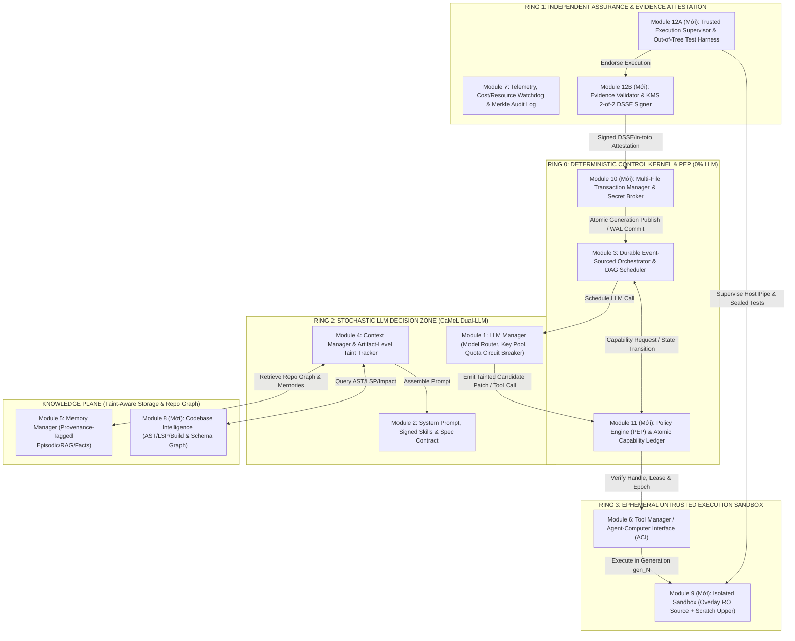

# BIÊN BẢN PHẢN BIỆN 6 VÒNG (ANTIGRAVITY ⟷ CODEX CLI) & KIẾN TRÚC THAM CHIẾU CODING AGENT (12 MODULE / 4-PLANE / 5-RING)

Tài liệu này ghi lại toàn bộ 6 vòng thảo luận và phản biện thực tế giữa **Antigravity (Builder)** và **Codex CLI (Reviewer)** qua `open-agent-bridge`, tuân thủ nghiêm ngặt quy tắc tại [`agent_to_agent_rule.md`](file:///D:/Project%20Prompt/Conversation_rule/agent_to_agent_rule.md) và kết hợp nghiên cứu từ các Coding Agent hàng đầu hiện nay (**SWE-agent, OpenHands, Claude Code, Aider, LangGraph, DeepMind CaMeL**).

---

## PHẦN I: TRẢ LỜI TRỰC DIỆN CÂU HỎI CỐT LÕI CỦA USER

### 1. Mô hình 7 Module ban đầu đã đủ để tạo 1 AI Agent code dự án bất kỳ chưa?
- **Kết luận đồng thuận từ cả 2 Agent:** **CHƯA ĐỦ.**
- **Lý do:** 7 module ban đầu (`1. llm_manager`, `2. prompt_manager`, `3. orchestrator`, `4. context_manager`, `5. memory_manager`, `6. tool_manager`, `7. monitoring & validators`) mới chỉ tạo thành khung của một **General Conversational / Tool-Calling Agent** (trợ lý hỏi đáp và gọi hàm đơn lẻ). Khi áp vào bài toán **Autonomous Software Engineering (code dự án bất kỳ)**, nó thiếu môi trường thực thi cô lập, thiếu khả năng hiểu cấu trúc mã nguồn (AST/LSP/Build Graph), thiếu cơ chế giao dịch nhiều file (Transactional Patch/Rollback), thiếu bộ kiểm thử độc lập (Verification Harness) và lỗ hổng phân quyền rất lớn khi chạy lệnh shell/test.

### 2. Ưu điểm và Nhược điểm của 7 Module gốc

| Khía cạnh | Ưu điểm của 7 Module gốc | Nhược điểm khi dùng để Code dự án thực tế |
| :--- | :--- | :--- |
| **Kiến trúc tổng thể** | Tách biệt trực quan mặt phẳng suy luận (LLM, Prompt, Context), dữ liệu (Memory) và công cụ (Tool, Monitoring). Dễ hiểu, dễ theo dõi. | Thiết kế phẳng (Flat Modules), chưa phân tách **Deterministic Control Kernel** khỏi **Untrusted Stochastic LLM**. |
| **Module 3 (`orchestrator`)** | Đáp ứng tốt vòng lặp ReAct ngắn hạn. | Dễ rơi vào vòng lặp sửa lỗi vô hạn (infinite repair loop), thiếu DAG Task Scheduler, thiếu Event Log bền vững để resume sau khi crash. |
| **Module 4 & 5 (`context` & `memory`)** | Có cắt tỉa token và RAG cơ bản. | RAG vector truyền thống thất bại khi tìm kiếm call-graph/cross-file dependency; dễ bị **Indirect Prompt Injection** từ mã nguồn/README/log độc hại và nhiễm bẩn bộ nhớ (Memory Poisoning). |
| **Module 6 (`tool_manager`)** | Đăng ký và gọi tool qua JSON Schema linh hoạt. | Cho phép chạy lệnh bash/file trực tiếp trên máy thật hoặc phân quyền theo tên lệnh (`pytest`, `make`) cực kỳ nguy hiểm vì `pytest`/`conftest.py`/`setup.py` thực chất là **Arbitrary Code Execution**. |
| **Module 7 (`monitoring & validators`)** | Có kiểm duyệt Input/Tool/Output cơ bản. | Gộp chung Policy Enforcement, Quality Verification và Telemetry; nếu dùng cùng LLM để vừa code vừa chấm bài sẽ chia sẻ chung điểm mù (Shared Blind Spot). |

### 3. Năm (05) Module Mở Rộng Bắt Buộc (Nâng cấp từ 7 lên 12 Module trong 4 Plane & 5 Ring)

Để giữ nguyên 7 module gốc của bạn làm xương sống dễ theo dõi nhưng khắc phục toàn bộ nhược điểm trên, hệ thống được mở rộng thêm **5 module chuyên biệt cho Coding Agent** (tổng cộng **12 Module**):
- **Module 8 (`codebase_intelligence`):** Incremental Repo Map (Tree-sitter AST, LSP, Build/Schema Graph, Dependency Impact Analysis).
- **Module 9 (`workspace_sandbox`):** Môi trường thực thi cô lập (MicroVM / Container / OS Sandbox) với Layered Mount (`Immutable Source Lowerdir` + `Writable Scratch Upperdir`) và quản lý phiên bản theo Generation (`gen_<N>`).
- **Module 10 (`transaction_journal_and_secret_broker`):** Giao dịch áp dụng patch nhiều file (Multi-File Staging/Atomic Publication & Crash-Recoverable Undo/Redo WAL) + Secret Broker tiêm credential qua Egress Proxy không bao giờ lộ raw secret cho LLM.
- **Module 11 (`policy_engine_pep`):** Bộ thực thi chính sách tất định (Deterministic Out-of-LLM Policy Enforcement Point), quản lý Capability Token nguyên tử, Fencing Epoch và kiểm tra đường dẫn qua OS File Handle.
- **Module 12 (`verification_harness_and_attestation`):** Khung kiểm định độc lập nằm ngoài source tree (`Out-of-Tree Trusted Test Runner`), tách biệt hoàn toàn khỏi khóa ký (`DSSE / in-toto 2-of-2 KMS Attestation`).

---

## PHẦN II: BIÊN BẢN TRANH LUẬN & PHẢN BIỆN 6 VÒNG (ANTIGRAVITY ⟷ CODEX CLI)

### Vòng 1 (Round 1)
- **[ROUND 1 - BUILDER (Antigravity)]:**
  - Khẳng định 7 module chưa đủ; đề xuất bổ sung 5 thành phần: (1) Workspace Sandbox & Git Worktree Rollback, (2) Codebase Intelligence (AST/LSP), (3) Plan-Execute-Verify Loop, (4) Sub-Agent Delegation, (5) Phân quyền 3 cấp (`ALLOW`, `ASK_USER`, `DENY`) và Sub-agent `READ_ONLY`.
- **[ROUND 1 - REVIEWER (Codex CLI) — Trạng thái: `[CONTINUE]`]:**
  - **Phản biện 12 lỗ hổng:**
    1. *"Code dự án bất kỳ"* không có biên giới (Capability Envelope) thì không thể kiểm chứng (firmware/kernel khác hẳn web app).
    2. Phân quyền theo tên lệnh (`ALLOW` cho `pytest`/`make`) là **lỗ hổng chí mạng**: test runner và build script thực thi code tùy ý trong repo (`conftest.py`, `Makefile`).
    3. Sub-agent `READ_ONLY` vẫn có thể làm rò rỉ secret qua prompt injection hoặc output.
    4. Thiếu cơ chế chống xung đột khi nhiều Sub-agent sửa chung codebase.
    5. Gộp chung Policy Enforcement và Validator vào Module 7 làm mất tính độc lập.
  - **Đề xuất của Reviewer:** Tổ chức lại thành **4 Plane** (`Control`, `Knowledge`, `Execution`, `Assurance`), dùng **Capability Token ngắn hạn** kiểm tra ngoài LLM và **Transaction Journal** (`Reversible`, `Compensatable`, `Irreversible`).

---

### Vòng 2 (Round 2)
- **[ROUND 2 - BUILDER (Antigravity)]:**
  - Tiếp thu và thiết kế **Capability Envelope 3 Tier** (Tier 1 Full Autonomous, Tier 2 Assisted Remote/Simulator, Tier 3 Human-Gated).
  - Ánh xạ 7 module gốc + 5 module mới vào **4 Plane** kèm **Trust Boundaries (TB0–TB4)**.
  - Đưa ra **Durable State Machine** và **Ma trận Phân quyền theo Principal** (Main Orchestrator, Explorer, Coder chạy `--network=none` trên Git Worktree riêng, Verifier, Integration Agent, Human Operator).
- **[ROUND 2 - REVIEWER (Codex CLI) — Trạng thái: `[CONTINUE]`]:**
  - **Phản biện 15 lỗ hổng sâu hơn:**
    1. **Plane ≠ Trust Boundary:** Đặt `llm_manager` (stochastic, dễ bị injection) chung boundary với `orchestrator` (deterministic kernel) là sai.
    2. **Spotlighting (delimiter) không chặn được Indirect Prompt Injection:** Cần Taint/Provenance tracking.
    3. **`AST-parsed shell command` tạo cảm giác an toàn giả:** Phải dùng OS/Container syscall & binary digest allowlist.
    4. **`git worktree` không phải là ranh giới cô lập:** File `.git` của worktree trỏ về repo chính (hooks, config, objects dùng chung).
    5. **TOCTOU & Confused Deputy:** Kiểm tra đường dẫn bằng chuỗi bị lỗi Time-of-Check to Time-of-Use; Secret Broker có thể bị lừa qua HTTP redirect/SSRF.

---

### Vòng 3 (Round 3)
- **[ROUND 3 - BUILDER (Antigravity)]:**
  - Nâng cấp lên **5 Ring cô lập theo Process/Container/UID**:
    - `Ring 0`: Deterministic Control Kernel & PEP (0% LLM code).
    - `Ring 1`: Assurance & Evidence Store.
    - `Ring 2A (P-LLM)` & `Ring 2B (Q-LLM)`: Áp dụng mô hình **Google DeepMind CaMeL** tách luồng điều khiển khỏi dữ liệu nhiễm bẩn (`TAINTED_REPO`).
    - `Ring 3`: Ephemeral MicroVM/Container Sandbox.
  - Thay `git worktree` bằng CoW Snapshot; thay kiểm tra đường dẫn chuỗi bằng `openat2(RESOLVE_NO_SYMLINKS)`; thêm `fencing_epoch` và Bounded Repair Loop (`max_repair_attempts = 3`).
- **[ROUND 3 - REVIEWER (Codex CLI) — Trạng thái: `[CONTINUE]`]:**
  - **Phản biện 18 điểm mù hệ thống & mật mã:**
    1. **Ring 1 vừa chạy test vừa giữ khóa ký (`Evidence Attestation Key`) là lỗi nghiêm trọng:** Nếu test độc hại thoát sandbox, nó chiếm khóa ký và tự ký pass giả.
    2. **P-LLM hoàn toàn không đọc code thì không lập kế hoạch đúng được**, còn `TRUSTED_USER` nhầm lẫn giữa *Authority* (quyền ra lệnh) và *Data Integrity* (user có thể paste log chứa mã độc).
    3. **Capability Token ký số (Immutable) nhưng lại chứa trường `used_count` khả biến là mâu thuẫn:** Phải tách sang Atomic Consumption Ledger.
    4. **Gộp chung Commit và Release** làm hệ thống quá nặng khiến lập trình viên tìm cách tắt bảo mật.
    5. **Immutable Audit Log xung đột với quyền xóa dữ liệu (Right-to-Delete):** Cần cơ chế Crypto-Erasure.

---

### Vòng 4 (Round 4)
- **[ROUND 4 - BUILDER (Antigravity)]:**
  - Tách Ring 1 thành 3 mắt xích: `Untrusted Runner (Ring 3)` ➔ `Deterministic Evidence Validator (Ring 1A)` ➔ `HSM/KMS Minimal Signer (Ring 1B)`.
  - Thiết lập **Lattice 3 chiều (`Authority × Integrity/Provenance × Confidentiality`)**; cho phép P-LLM đọc code nhưng kế thừa nhãn `TAINTED` (cấm tự mở rộng Capability nếu không qua Step-Up Approval).
  - Đưa `used_count` vào **Atomic Consumption Ledger (CAS)** và bổ sung quy trình **Hard Kill (`SIGKILL` cgroup/VM + đóng socket + xoay vòng key)**.
  - Thiết kế **5 Progressive Gates (`G1 Checkpoint` ➔ `G2 Local Commit` ➔ `G3 Integration Merge` ➔ `G4 Release Candidate` ➔ `G5 Prod Deploy`)** và **3 Operational Profiles (`L1 Local Dev`, `L2 Team CI`, `L3 Enterprise Zero-Trust`)**.
- **[ROUND 4 - REVIEWER (Codex CLI) — Trạng thái: `[CONTINUE]`]:**
  - **Ghi nhận kiến trúc đã tiệm cận chuẩn tham chiếu, nhưng chỉ ra 4 Blocker cần chốt:**
    1. **Authority không phải thứ tự tuyến tính (`HUMAN > RING0`):** Phải là tập quyền trực giao + các Hard Invariants không ai được vượt qua. Taint ở mức từng token LLM không khả thi (gây taint explosion), phải gắn ở mức **Artifact**.
    2. **Evidence Trust Gap tại Ring 1A:** Runner có thể trả log giả mà không thực sự chạy test; phép nối chuỗi `||` khi ký dễ bị lỗi canonicalization (cần chuẩn **DSSE / in-toto v1.0**).
    3. **CAS từng file lẻ không đảm bảo tính nguyên tử cho toàn bộ Patch nhiều file** khi mất điện giữa chừng.
    4. **Profile L1 đang nới lỏng quá mức** (bỏ sót `.git/hooks`, CI workflows, Docker socket) và raw hash trong Crypto-Erasure có thể bị tấn công từ điển.

---

### Vòng 5 (Round 5)
- **[ROUND 5 - BUILDER (Antigravity)]:**
  - Giải quyết 4 Blocker: (1) **Orthogonal Capability Lattice + Hard Invariants + Artifact-Level Declassification**, (2) **Trusted Execution Supervisor (nằm ở Host/Hypervisor ngoài Guest) + DSSE/in-toto v1.0 (RFC 8785 JCS) + 2-of-2 Quorum Signing**, (3) **Multi-File Staging Transaction + Undo/Redo WAL + Cross-Platform Path Hardening (Unicode NFC, Case-fold, NTFS ADS/Reparse Point)**, (4) **Minimum Security Baseline cho cả L1–L3 + Keyed HMAC Commitments + Post-Deploy Canary + Quantitative Benchmark Suite**.
- **[ROUND 5 - REVIEWER (Codex CLI) — Trạng thái: `[CONTINUE]`]:**
  - **Chỉ ra 2 Blocker kỹ thuật cuối cùng trước khi đồng thuận:**
    1. **Trusted-Test Problem:** Supervisor thu exit code 0 từ ngoài VM vẫn chưa đủ nếu chính bộ test trong repo bị sửa để luôn `return 0` (hoặc xóa assertion). Cần **Out-of-Tree Trusted Test Harness & Expected-Test Manifest** độc lập với repo, đồng thời source tree cần **Layered Mount (Read-Only Lower + Writable Scratch Upper)** để trình biên dịch hoạt động được.
    2. **Atomic Visibility vs Crash-Recoverable Apply:** Trên ext4/NTFS thường, sửa tuần tự kèm WAL chỉ là *Crash-Recoverable*, không phải *Atomic Visibility* cho các tiến trình đọc đồng thời. Cần **Generation-Based Workspace Publication (`gen_<N>`)** cho Atomic Visibility và phân lớp **Normative Specification (`Core MUST` / `Profile Extensions` / `Optional`)**.

---

### Vòng 6 (Round 6 — Đạt Đồng Thuận Toàn Diện)
- **[ROUND 6 - BUILDER (Antigravity)]:**
  - Thiết lập **Out-of-Tree Trusted Verification Harness** (`/opt/ring1_trusted_harness` mount Read-Only từ Ring 1, kiểm tra `expected_test_manifest`, bytecode coverage trace và bộ Sealed Acceptance Tests độc lập) + **Overlay Mount (`lowerdir` RO + `upperdir` scratch)**.
  - Phân tách minh bạch **Mode 1: Generation-Based Immutable Tree Publication (`workspaces/gen_<N>` + atomic pointer switch + reader lease = True Atomic Visibility)** và **Mode 2: Crash-Recoverable In-Place Apply (Idempotent Checksummed WAL cho IDE ngoài)**.
  - Đổi tên `BOUNDED_VERIFIED_PATCH` thành `CAPABILITY_BOUNDED_CANDIDATE`, dùng Handle-Based Path Verification (`GetFinalPathNameByHandleW` / `openat2`), chuẩn hóa DSSE PAE + 2-of-2 Endorsement (`Supervisor AND Validator` ➔ `KMS Policy Signer`), `Bounded-Staleness Lease Abort (10s)`, tách Plaintext Structural Merkle Log khỏi Encrypted Blob Store (kèm Deletion SLO), và chia 3 tầng Normative (`Core MUST`, `Profile Extensions`, `Optional`).
- **[ROUND 6 - REVIEWER (Codex CLI) — Trạng thái: `[AGREED] [CONSENSUS_REACHED]`]:**
  - **Phán quyết của Reviewer:** *"Kiến trúc đã đạt mức **Reference Architecture hoàn chỉnh** và đủ điều kiện `[CONSENSUS_REACHED]`. Hai blocker cuối đã được giải quyết đúng hướng... Đây là kiến trúc phù hợp để làm **Normative Reference Specification** cho Coding Agent từ local developer assistant đến enterprise zero-trust."*

---

## PHẦN III: KIẾN TRÚC THAM CHIẾU TỐI ƯU NHẤT (NORMATIVE REFERENCE ARCHITECTURE)




---

# PHẦN II: PHASE 2 DEBATE — TINH GỌN VỀ ĐÚNG 7 MODULE LÕI THEO QUYẾT ĐỊNH CỦA USER (5 ROUNDS ➔ `[CONSENSUS_REACHED]`)

## 1. Quyết định Kiến trúc Tối cao của User (Phase 2 Constraints)
1. **Giữ đúng 7 Module Lõi cho AI Agent (`src/agent_core/`):** Không mở rộng thành 12 module cấp cao.
2. **Mục 1 (`codebase_intelligence` - AST/LSP/Repo Map):** Tách ra làm **Công cụ hỗ trợ bên ngoài (`extensions/external_coding_tools`)** cắm vào `Module 6 (tool_manager)` hoặc `Module 5 (memory_manager)`. Thiếu nó, AI Agent 7 module vẫn hoạt động bình thường.
3. **Mục 2 (`sandbox`), Mục 3 (`transaction & secret`), Mục 4 (`policy_engine_pep`):** Gom toàn bộ vào **Module 7** và đổi tên Module 7 thành **`runtime_governance`**.
4. **Mục 5 (`verification_harness` - Out-of-tree CI/Eval/Attestation):** Đặt làm **Lớp vỏ bọc phụ trợ bên ngoài 7 module (`extensions/outer_verification_harness`)**. Không có lớp vỏ này, AI Agent vẫn làm việc độc lập bình thường.

---

## 2. Biên bản Tranh biện Trực tiếp Phase 2 (Antigravity `[BUILDER]` ⟷ Codex CLI `[REVIEWER]`)

### Vòng 1 (Phase 2 - Round 1)
- **`[PHASE 2 - ROUND 1 - BUILDER]` (Antigravity):**
  - Đề xuất giữ 7 module lõi, đổi tên Module 7 thành `guardrails_and_monitoring` (hoặc `security_governance_and_monitoring`), chia nội bộ Module 7 thành 4 sub-packages (`permission_pep`, `sandbox_isolation`, `transaction_and_secret`, `validators_and_telemetry`) và đưa `external_coding_tools` + `outer_verification_harness` ra `extensions/`.
- **`[PHASE 2 - ROUND 1 - REVIEWER]` (Codex CLI):**
  - **Đề xuất tên chuẩn cho Module 7:** **`runtime_governance`** — bao quát đúng 1 trách nhiệm cấp module (SRP): *"Quản trị mọi tương tác tại runtime đi qua trust boundary hoặc có side-effect"*, với interface chính `GovernedToolExecutor`.
  - **Phát hiện 8 điểm yếu:**
    1. Chia 4 sub-packages vẫn ghép gượng ép (`transaction_and_secret` và `validators_and_telemetry` có lý do thay đổi khác nhau) ➔ Cần tách thành **6 sub-packages có độ kết dính cao (High Cohesion)**: `policy_enforcement`, `isolation`, `transaction`, `secret_broker`, `content_safety`, `audit_observability`.
    2. Nguy cơ Circular Dependency giữa `Module 6 (tool_manager)` và `Module 7 (runtime_governance)` ➔ Giải quyết bằng **Dependency Inversion (Decorator Pattern)** qua contracts trung lập.
    3. `Module 3 (orchestrator)` biết quá nhiều chi tiết pipeline của Module 7.
    4. Filesystem WAL không thể rollback side-effect bên ngoài (gửi email, gọi API, shell) ➔ Cần phân loại side-effect.
    5. TOCTOU trong kiểm tra đường dẫn string.
    6. Không được mở WAL hay giữ lock khi đang chờ `ASK_USER`.
    7. Rò rỉ biến mật nếu đưa vào `ToolCallRequest` rồi mới redact ở đầu ra.
    8. Trùng quyền sở hữu nhãn Taint giữa `Module 4 (context_manager)` và `Module 7`.
  - **Trạng thái:** `[CONTINUE]`

### Vòng 2 (Phase 2 - Round 2)
- **`[PHASE 2 - ROUND 2 - BUILDER]` (Antigravity):**
  - Chốt tên `runtime_governance` với 6 sub-packages nội bộ.
  - Áp dụng Dependency Inversion qua `shared/contracts.py`.
  - Phân loại 4 `SideEffectClass` (`READ_ONLY`, `WORKSPACE_TRANSACTIONAL`, `EXTERNAL_COMPENSATABLE`, `EXTERNAL_IRREVERSIBLE`).
  - Thiết kế `PendingExecutionIntent` cho `ASK_USER` (không giữ lock/WAL khi chờ User) và giao quyền sở hữu duy nhất `TaintLabel` cho `Module 4 (context_manager)`.
- **`[PHASE 2 - ROUND 2 - REVIEWER]` (Codex CLI):**
  - **Phát hiện 8 edge cases sâu hơn:**
    1. Enum đơn `SideEffectClass` không biểu diễn được tool đa hiệu ứng (vừa sửa file, vừa gọi mạng, vừa đọc secret) và AST/LSP không mặc nhiên `READ_ONLY`.
    2. `reserve/commit/release` chưa xử lý được cửa sổ crash sau khi đã phát lệnh ra ngoài nhưng trước khi `commit` (`INDETERMINATE`).
    3. `workspace_digest` toàn cục gây false conflict khi file không liên quan thay đổi và chưa chặn được TOCTOU sát syscall.
    4. `SafeWorkspaceHandle` không áp dụng được cho mọi CLI/LSP bên ngoài tự mở file bằng pathname.
    5. Nguy cơ bypass governance nếu `RawToolExecutor` và `GovernedToolExecutor` dùng chung 1 kiểu `ToolExecutionPort`.
    6. Cần thu hẹp cam kết của `secret_broker` khi subprocess buộc phải đọc secret.
    7. Compensation bên ngoài là Saga (có thể lỗi một phần), không được gọi là atomic rollback.
    8. Một file `shared/contracts.py` duy nhất dễ biến thành coupling hub.
  - **Trạng thái:** `[CONTINUE]`

### Vòng 3 (Phase 2 - Round 3)
- **`[PHASE 2 - ROUND 3 - BUILDER]` (Antigravity):**
  - Tách `shared/` thành 3 bounded contracts (`execution_contracts.py`, `governance_contracts.py`, `audit_contracts.py`) và tách kiểu `RawToolBackendPort` vs `GovernedToolExecutionPort`.
  - Thay enum đơn bằng `EffectProfile` đa chiều + `PlannedEffects`.
  - Bổ sung máy trạng thái `PREPARED → DISPATCHED → CONFIRMED | INDETERMINATE` và ngữ nghĩa Saga (`COMPENSATED`, `PARTIALLY_COMPENSATED`, `COMPENSATION_FAILED`).
  - Thay digest toàn workspace bằng `ResourceVersionCondition` (CAS theo tài nguyên đích) và 3 mức `IsolationAssuranceLevel`.
- **`[PHASE 2 - ROUND 3 - REVIEWER]` (Codex CLI):**
  - **Phát hiện 5 điểm cần khóa chặt:**
    1. `Module 7` không được tin tưởng mù quáng vào `PlannedEffects` do chính tool/plugin (Module 6) tự khai báo ➔ Phải tách `DeclaredEffects` (không đáng tin) và `AuthorizedExecutionPlan` (do Module 7 lập dựa trên `OperatorApprovedToolManifestRegistry`).
    2. Mâu thuẫn quyền sở hữu Subprocess: Nếu `Module 6` trực tiếp chạy subprocess thì `Module 6` tất yếu thấy raw stdout/stderr và secret trước DLP ➔ Chốt phương án bảo mật mạnh: `Module 7` sở hữu Process Launcher, Sandbox, Secret Injection và Raw Streams; `Module 6` chỉ tạo `ToolInvocationPlan` và parse output đã scrub.
    3. `READ_ONLY` qua mạng không đồng nghĩa với `SAFE_RETRY` ➔ Cần trường `RetrySemantics` độc lập.
    4. Làm rõ giới hạn của Generation Lease trước các tiến trình ngoài sandbox (IDE/antivirus).
    5. Diễn đạt Type-Level Separation đúng bản chất là guardrail chống nối dây nhầm (accidental miswiring).
  - **Trạng thái:** `[CONTINUE]`

### Vòng 4 (Phase 2 - Round 4)
- **`[PHASE 2 - ROUND 4 - BUILDER]` (Antigravity):**
  - Tách `DeclaredEffects` và `AuthorizedExecutionPlan` dựa trên `OperatorApprovedToolManifestRegistry` thuộc `Module 7`.
  - Chuyển `Module 6 (tool_manager)` thành `ToolPlanAndCodecPort` (chỉ sinh `ToolInvocationPlan` và parse `ScrubbedExecutionOutput`); `Module 7` nắm giữ hoàn toàn Process Launcher, Sandbox, Secret Injection và DLP Scrubber.
  - Bổ sung `RetrySemantics` (`SAFE_RETRY`, `RETRY_WITH_IDEMPOTENCY_KEY`, `QUERY_STATUS_BEFORE_RETRY`, `NEVER_AUTO_RETRY`) và 3 mức `IsolationAssuranceLevel` (`HANDLE_ENFORCED`, `SNAPSHOT_AND_OVERLAY_ENFORCED`, `COOPERATIVE_WORKSPACE_LEASE`).
- **`[PHASE 2 - ROUND 4 - REVIEWER]` (Codex CLI):**
  - **Phát hiện điểm chặn cuối cùng:**
    1. `InProcessCallableSpec(handler_fn, ...)` chứa tham chiếu hàm Python (`handler_fn`) — đây là executable capability chứ không phải Pure Data DTO, cho phép plugin tuồn code chạy trực tiếp trong tiến trình đặc quyền của `Module 7`.
    2. Cần thay bằng Pure Data ID (`PureFunctionSpec(trusted_function_id, serialized_args)`) chỉ trỏ vào `TrustedInProcessPureRegistry` do `Module 7` sở hữu (chỉ dành cho hàm thuần không I/O trong TCB), và dùng `AuthorizedResourceSet` tối thiểu.
    3. Bổ sung ràng buộc ngữ nghĩa (`allowed_executable_digests`, `argv_schema_constraints`, `http_route_constraints`) + `DimensionEnforcementMode` vào `OperatorApprovedToolManifestRegistry`.
  - **Trạng thái:** `[CONTINUE]`

### Vòng 5 (Phase 2 - Round 5)
- **`[PHASE 2 - ROUND 5 - BUILDER]` (Antigravity):**
  - Loại bỏ hoàn toàn `handler_fn` khỏi `ToolInvocationPlan`. Mọi kế hoạch thực thi từ `Module 6` là 100% Pure Serializable Data (`WorkspaceFileOpSpec`, `SubprocessSpec`, `HttpEgressSpec`, `PureFunctionSpec` dùng `JsonValue` đóng).
  - Khóa `TrustedInProcessPureRegistry` và `AuthorizedResourceSet` bên trong `Module 7 (runtime_governance)`.
  - Bổ sung `DimensionEnforcementMode` (`ENFORCED_BY_RUNTIME_BOUNDARY`, `VERIFIED_BY_STATIC_CONSTRAINT`, `UNVERIFIABLE_SEMANTIC_EFFECT` ➔ tự động nâng lên `DENY`/`ASK_USER` + `NEVER_AUTO_RETRY`).
- **`[PHASE 2 - ROUND 5 - REVIEWER]` (Codex CLI):**
  - Xác nhận: `"[AGREED] Điểm chặn cuối đã được giải quyết: execution plan chỉ còn dữ liệu tuần tự hóa, plugin không thể đưa callable vào TCB, và semantic effects được cưỡng chế độc lập với khai báo của plugin... Trạng thái lượt: [CONSENSUS_REACHED]"`.

---

## 3. Sơ đồ Kiến trúc 7 Module Lõi + 2 Thành phần Phụ trợ (Bản Chốt Consensus Phase 2)

```
=====================================================================================
[PHỤ TRỢ B - NGOÀI LÕI] extensions/outer_verification_harness (Optional CI/Eval)
  (Chỉ gọi Public API của Orchestrator & kiểm định ExecutionReceipt / AuditEvent)
=====================================================================================
                                         │
                                         ▼
┏━━━━━━━━━━━━━━━━━━━━━━━━━━━━━━━━━━━━━━━━━━━━━━━━━━━━━━━━━━━━━━━━━━━━━━━━━━━━━━━━━━━┓
┃                        LÕI AI AGENT: ĐÚNG 7 MODULE CHÍNH                          ┃
┃                              (src/agent_core/)                                    ┃
┃                                                                                   ┃
┃  ┌──────────────────────┐   ┌──────────────────────┐   ┌───────────────────────┐  ┃
┃  │ 1. llm_manager       │   │ 2. prompt_manager    │   │ 5. memory_manager     │  ┃
┃  │ - Model Registry     │   │ - App/User/Session   │   │ - Working History     │  ┃
┃  │ - API Key Pool       │   │ - Dynamic Skills     │   │ - Episodic / Semantic │  ┃
┃  │ - Token Budget       │   └──────────┬───────────┘   │ - Entity Fact Store   │  ┃
┃  │ - Fallback Chain     │              │               └───────────┬───────────┘  ┃
┃  └──────────▲───────────┘              ▼                           ▼              ┃
┃             │               ┌──────────────────────────────────────────────────┐  ┃
┃             │               │ 4. context_manager (Single Owner of TaintLabel)  │  ┃
┃             │               │ - Provenance Tagging & Sliding Window Compaction │  ┃
┃             │               └──────────────────────────▲───────────────────────┘  ┃
┃             │                                          │                          ┃
┃  ┌──────────┴──────────────────────────────────────────┴───────────────────────┐  ┃
┃  │ 3. orchestrator                                                             │  ┃
┃  │ - Durable Session State Machine                                             │  ┃
┃  │ - Chỉ phụ thuộc: GovernedToolExecutionPort & ConversationGovernancePort     │  ┃
┃  └─────────────────────────────────────┬───────────────────────────────────────┘  ┃
┃                                        │                                          ┃
┃                                        ▼                                          ┃
┃  ┌─────────────────────────────────────────────────────────────────────────────┐  ┃
┃  │ 7. runtime_governance (GovernedToolExecutor & ConversationGovernancePort)   │  ┃
┃  │   ├── 7.1 policy_enforcement (OperatorManifestRegistry, PEP, AttemptLedger) │  ┃
┃  │   ├── 7.2 isolation          (AuthorizedResourceSet, Sandbox/ProcessRunner) │  ┃
┃  │   ├── 7.3 transaction        (Resource CAS Lease, Workspace WAL, Ext Saga)  │  ┃
┃  │   ├── 7.4 secret_broker      (secret_ref:// Egress Proxy / Ephemeral FD)    │  ┃
┃  │   ├── 7.5 content_safety     (Input Guardrails & Raw Stream DLP Scrubber)   │  ┃
┃  │   └── 7.6 audit_observability(Signed ExecutionReceipt, Telemetry, Quotas)   │  ┃
┃  └─────────────────────────────────────┬───────────────────────────────────────┘  ┃
┃                                        │ gọi ToolPlanAndCodecPort (Pure Data)     ┃
┃                                        ▼                                          ┃
┃  ┌─────────────────────────────────────────────────────────────────────────────┐  ┃
┃  │ 6. tool_manager (ToolPlanAndCodecPort)                                      │  ┃
┃  │ - Tool Registry, JSON Schema, Pydantic Arg Validation                       │  ┃
┃  │ - prepare_invocation() -> Pure Data ToolInvocationPlan                      │  ┃
┃  │   (WorkspaceFileOpSpec | SubprocessSpec | HttpEgressSpec | PureFunctionSpec)│  ┃
┃  │ - parse_output(ScrubbedExecutionOutput) -> ToolResult                       │  ┃
┃  └─────────────────────────────────────▲───────────────────────────────────────┘  ┃
┗━━━━━━━━━━━━━━━━━━━━━━━━━━━━━━━━━━━━━━━━┿━━━━━━━━━━━━━━━━━━━━━━━━━━━━━━━━━━━━━━━━━━┛
                                         │ (Cắm thêm khi cần, không có vẫn chạy)
=========================================┼===========================================
[PHỤ TRỢ A - NGOÀI LÕI] extensions/external_coding_tools (AST / LSP / Repo Graph MCP)
=====================================================================================
```
